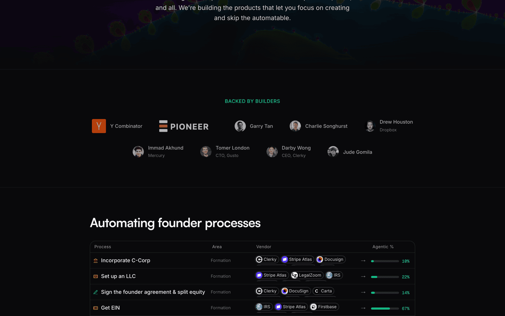
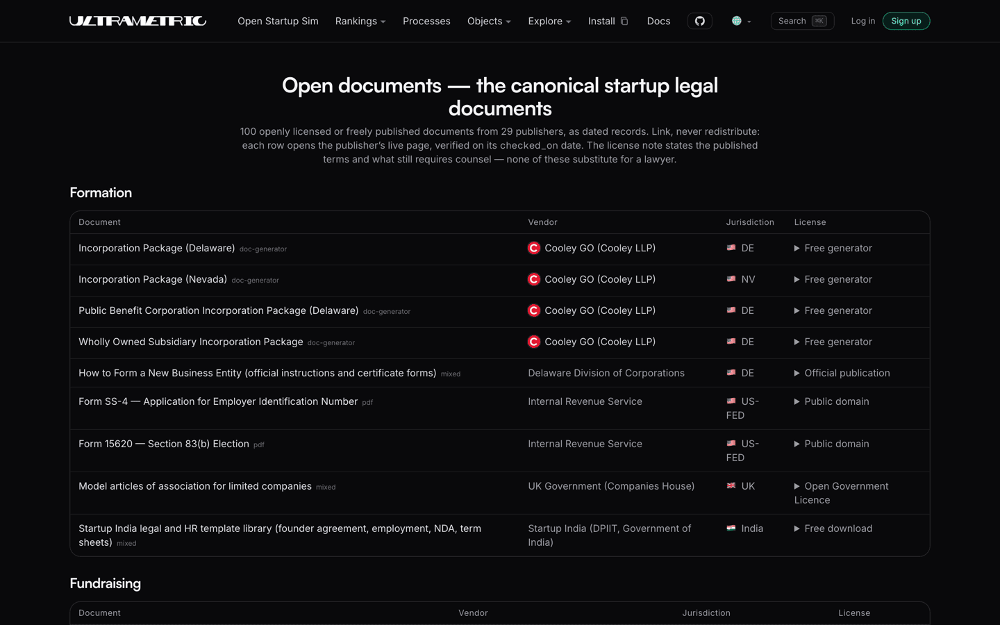

**Everything a founder (or their agent) needs to start and run a company: every
[process](#processes) step by step, the [vendors](#vendors) ranked, and the
[open modules](#open-modules) underneath.**

- **Use it:** [ultrametric.ai](https://ultrametric.ai) has [the processes](https://ultrametric.ai/processes) · [the rankings](https://ultrametric.ai/overall) · [the simulator](https://ultrametric.ai/startup-sim)
- **Improve it:** the open startup repo, [CONTRIBUTING.md](./CONTRIBUTING.md). Contest a verdict, add your country, add a module.
- **For agents:** open data, no keys. `curl https://ultrametric.ai/data/categories.json` ([use it from an agent](#use-it-from-an-agent))

**Contribution guides:** [Add your vendor](CONTRIBUTING.md#add-your-vendor) · [Add a process](CONTRIBUTING.md#add-a-process) · [Add a jurisdiction](CONTRIBUTING.md#add-a-jurisdiction) · [Add an open module](CONTRIBUTING.md#add-an-open-module)

**Talk:** [Discord](https://discord.com/invite/3aHky836qP) — founders and contributors

<!-- Legacy anchor: external links to #start-here predate the merge into this map. -->
<a id="start-here"></a>

## The open startup repo

The knowledge is the product: the processes, rankings, rules, and calculations a startup
runs on, committed here as plain JSON and markdown that any founder or agent can read,
verify, and correct by pull request.

[CONTRIBUTING.md](./CONTRIBUTING.md) · [DATA-LICENSE](./DATA-LICENSE)

## Video demo

A quick pass through the live site: home, the overall rankings, one market's leaderboard,
one process, and the startup simulator.


*The animated preview above is the quick pass; the full recording is committed at
[`docs/assets/readme/demo.mp4`](docs/assets/readme/demo.mp4).*

<a id="methodology"></a>

## Trust

Every score is computed from dated, cited evidence by a published method: unknowns stay
null, negative results stay published, and the founders' own products are disclosed and
adversarially bias-audited instead of favored.

[METHODOLOGY.md](./METHODOLOGY.md) · [ultrametric.ai/methodology](https://ultrametric.ai/methodology)

[](https://github.com/ultrametricai/ultrametric/actions/workflows/ci.yml)
<!-- stat-badges:start -->
[](https://ultrametric.ai)
[](https://ultrametric.ai/everything)
[](https://ultrametric.ai/methodology)
<!-- stat-badges:end -->

<!-- stats:start -->
As of the last full pipeline run: **96 rankings, 657 products, 37,159 judged verdicts.**
<!-- stats:end -->



<a id="vendors"></a>

## Open vendor rankings

Head-to-head rankings of the tools startups run on, judged story by story against hands-on
probes, code, docs, and community reports, with every verdict contestable.

<!-- arenas:start -->
**96 rankings** today, 657 products judged head to head — the full index is [ultrametric.ai/arenas](https://ultrametric.ai/arenas), and each ranking's records live under [`data/`](data/).
<!-- arenas:end -->

[ultrametric.ai/overall](https://ultrametric.ai/overall)


<a id="processes"></a>

## Open processes

Every founder process as a step-by-step graph: each step routed agent, form, or human,
timed, graded for reversibility, and wired to the ranked vendors that can run it.

[ultrametric.ai/processes](https://ultrametric.ai/processes) · [`processes/`](processes/)


## Examples

Three processes end to end, exactly as they render from the committed records:

- [Validate the idea](https://ultrametric.ai/processes/validate-the-idea) — picking the startup to work on
- [Generate a company name](https://ultrametric.ai/processes/generate-a-company-name) — picking a brand name
- [Apply to Y Combinator](https://ultrametric.ai/processes/apply-to-y-combinator) — the YC application, step by step


<!-- Legacy anchor: external links to #business-logic predate the open-modules/ rename. -->
<a id="business-logic"></a>

## Open modules

The startup math as source-cited code: cap tables, SAFE conversion, sale waterfalls,
runway, vesting, option tax, and filing deadlines, with every formula citing its source
and replaying the published worked examples in tests.

[`open-modules/README.md`](open-modules/README.md) · [`lib/openstartup/`](lib/openstartup/)

## Open situations

Trigger-driven guides for the work nobody schedules (a breach is live, a summons lands, a
tax notice arrives), sorted by how fast the clock runs.

[ultrametric.ai/situations](https://ultrametric.ai/situations) · [`processes/SITUATIONS.md`](processes/SITUATIONS.md)


<a id="add-your-country-or-state"></a>

## Founder country switch

Processes and vendor availability adapt to where you operate: the US is the baseline, with
country analogs and official filing links for the UK, India, Germany, France, Portugal,
and Canada, and adding your country is a schema-gated pull request.

[`jurisdictions/`](jurisdictions/) · [Add a jurisdiction](CONTRIBUTING.md#add-a-jurisdiction)

## Open docs

The canonical startup legal documents (SAFEs, board consents, offer letters) as dated,
verified links to their publishers, with the missing ones recorded as plainly as the
links.

[`open-documents/`](open-documents/) · [ultrametric.ai/open-documents](https://ultrametric.ai/open-documents)



## Open lore

The heuristics founders trade and the episodes that taught them, as sourced records: every
rule of thumb names its school and author, every episode carries a veracity grade, and the
disagreements between schools stay mapped on both sides.

[`lore/`](lore/) · [`resources/`](resources/)

## Getting acquired

The sale-of-the-company math is live (the waterfall module computes who gets what at any
price); the acquisition playbook itself is a mapped, open gap in `coverage/`, waiting for
its first records.

[Liquidity-event waterfall](open-modules/README.md#liquidity-event-waterfall) · [`coverage/`](coverage/)

## Open law

Dated legal rule cards, one proposition each, every card citing a primary authority with
an exact locator; a provider blog cannot establish law.

[`rules/`](rules/) · [`sources/`](sources/)

## Open artifacts

The documents and records that processes produce and consume (certificate of
incorporation, EIN letter, cap table), registered so every process declares what it makes
and what it needs.

[ultrametric.ai/artifacts](https://ultrametric.ai/artifacts) · [`processes/artifacts.json`](processes/artifacts.json)


## Open data structure

Every record validates against a published JSON Schema, and the company fields the
processes and modules read are themselves a typed, registered list.

[`schemas/`](schemas/) · [`processes/company-fields.json`](processes/company-fields.json)

```
data/
  categories.json            # every ranking: id, name, description
  {ranking}/
    products.json            # the products and their URLs
    stories.json             # what each product is judged on
    evidence/{product}.json  # dated evidence items, tiered by strength
    verdicts.json            # one judged cell per (product, story)
    rankings.json            # derived scores: computed, never hand-set
```

## Open startup simulator

A simulated company runs the whole process library end to end, every step routed agent,
form, or human, and everything it generates visibly marked simulated.

[ultrametric.ai/startup-sim](https://ultrametric.ai/startup-sim)


## Open skills for startups

`ultrametric init` installs the bundled agent skill, so a coding agent can retrieve a
process, run the agent-routed steps, and save progress from inside your repo.

[docs.ultrametric.ai/cli/install](https://docs.ultrametric.ai/cli/install) · [Agent Skills ranking](https://ultrametric.ai/arena/agent-skills)


<a id="for-ai-agents"></a>
<a id="use-it-from-an-agent"></a>

## Install Ultrametric

One npm package ships the CLI and MCP server; the data itself needs no install and no
keys.

```bash
npm install -g ultrametric@latest                   # CLI + MCP server + agent skill
curl https://ultrametric.ai/data/categories.json    # every ranking, raw JSON
curl https://ultrametric.ai/llms.txt                # the index for agents
```

[ultrametric.ai/get-started](https://ultrametric.ai/get-started) · [docs.ultrametric.ai](https://docs.ultrametric.ai)

## Upcoming

Finer-grained rankings, recorded probe sessions published on product pages, runtime
conformance testing behind the agent-readiness scores, and continuous re-judging as
evidence lands.

[`data/arena-roadmap.json`](data/arena-roadmap.json) · [`docs/COVERAGE-STRATEGY.md`](docs/COVERAGE-STRATEGY.md)

## License

Code is Apache-2.0 ([LICENSE](./LICENSE)); the data is viewable and quotable with
attribution, and bulk reuse needs written permission ([DATA-LICENSE](./DATA-LICENSE)).
