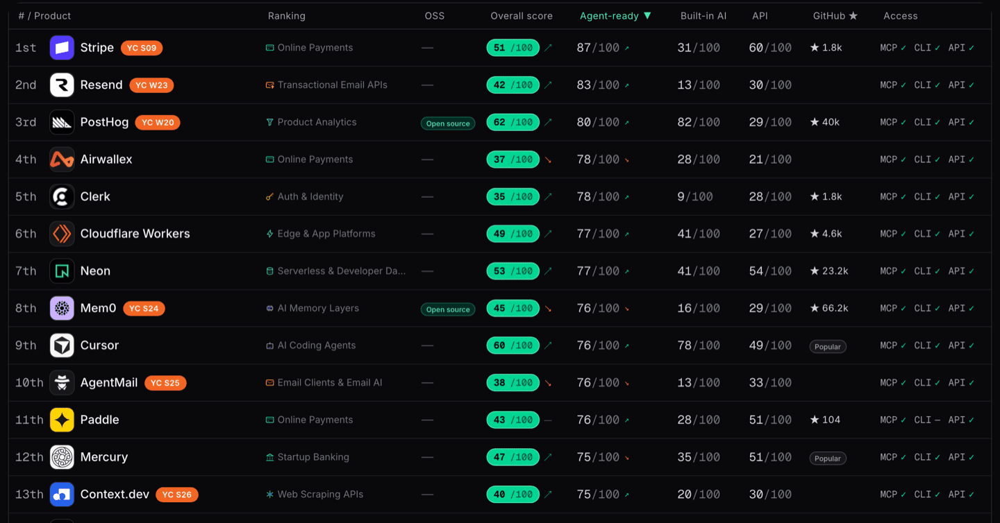
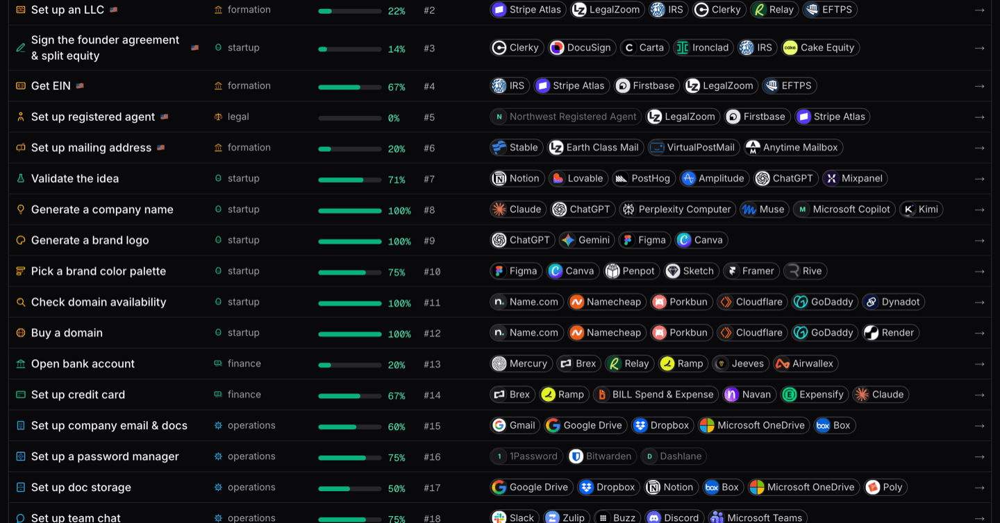
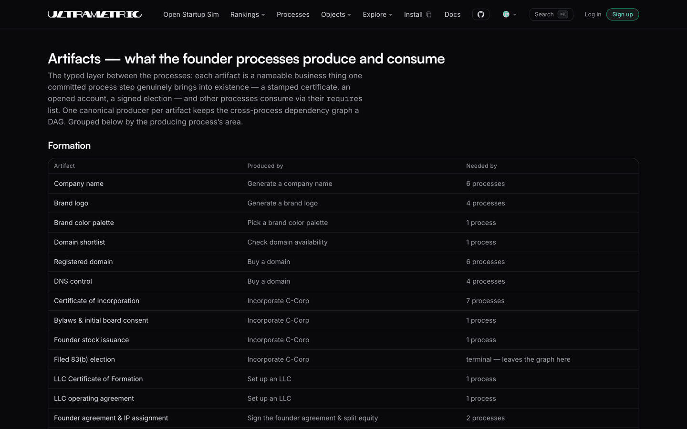
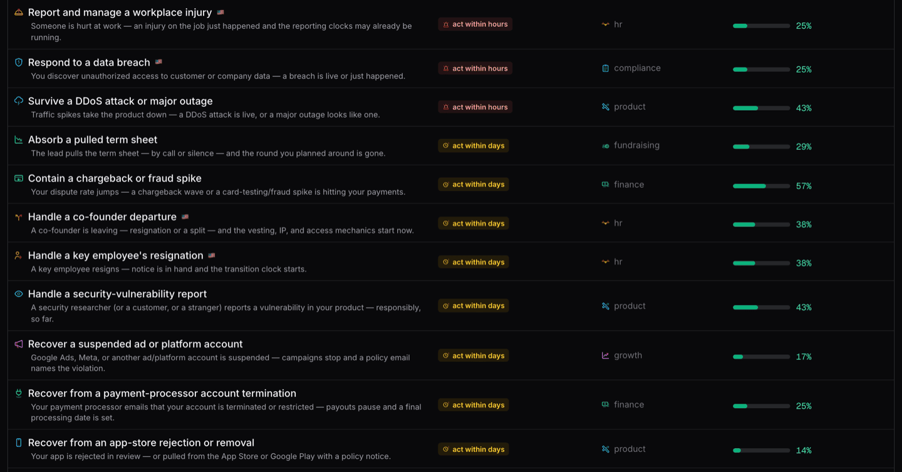
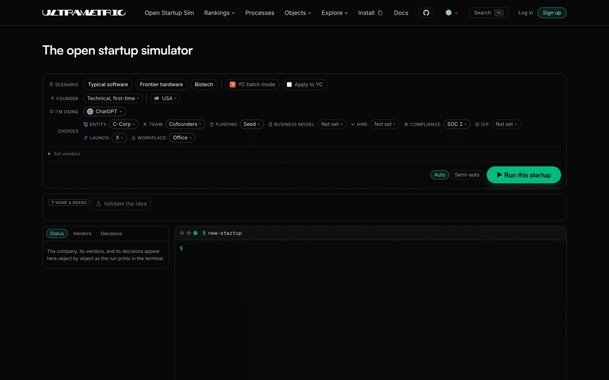
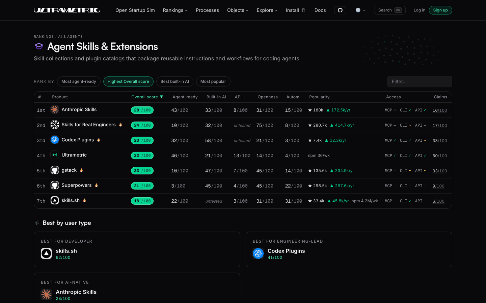

Ultrametric ([ultrametric.ai](https://ultrametric.ai)) is the open startup repo: every
founder [process](#open-processes) step by step, the [tools](#open-vendor-rankings) and
the [service providers](#startup-ecosystem) around a company (law firms included) ranked
by how well an agent can drive them, [company law](#open-law) mapped across
jurisdictions, the [lore](#open-lore) and its library recorded with sources, the open
[documents and artifacts](#open-artifacts) collected, the startup
[calculations](#open-modules) as tested code, all of it replayable in the
[simulator](https://ultrametric.ai/startup-sim) and readable by
[agents](#install-ultrametric) without keys. The aim: make starting and running a
company agentic, automated, and standardized across geographies.

**Contribution guides:** [Add your vendor](CONTRIBUTING.md#add-your-vendor) · [Add a process](CONTRIBUTING.md#add-a-process) · [Add a jurisdiction](CONTRIBUTING.md#add-a-jurisdiction) · [Add an open module](CONTRIBUTING.md#add-an-open-module)

**Talk:** [Discord](https://discord.com/invite/3aHky836qP) — founders and contributors

<!-- Legacy anchor: external links to #start-here predate the merge into this map. -->
<a id="start-here"></a>


## The open startup repo

This repo holds the processes, rankings, rules, and calculations a startup runs on, as
plain JSON and markdown that any founder or agent can read, verify, and correct by pull
request; the site at [ultrametric.ai](https://ultrametric.ai) renders it unchanged.

[CONTRIBUTING.md](./CONTRIBUTING.md) · [DATA-LICENSE](./DATA-LICENSE)

<a id="vendors"></a>

## Open vendor rankings

The tools startups run on, examined through an agentic lens: can an agent actually drive
each one, is it testable, and do the vendor's claims match what we found hands-on; the
rankings order products by how automatable they are, and every verdict can be contested.

<!-- arenas:start -->
**96 rankings** today, 657 products judged head to head — the full index is [ultrametric.ai/arenas](https://ultrametric.ai/arenas), and each ranking's records live under [`rankings/`](rankings/).
<!-- arenas:end -->

[ultrametric.ai/overall](https://ultrametric.ai/overall)



<a id="processes"></a>

## Open processes

Every founder process as a step-by-step graph: each step routed agent, form, or human,
timed, marked by how hard it is to undo, and wired to the ranked vendors that can run it.

The processes and the rankings cross-reference: each step lists its vendor options with
their judged scores, and [`processes/vendor-registry.json`](processes/vendor-registry.json)
maps every step's vendors to the market that ranks them.

[ultrametric.ai/processes](https://ultrametric.ai/processes) · [`processes/`](processes/)



### Examples

Three processes end to end:

- [Incorporate C-Corp](https://ultrametric.ai/processes/incorporate-c-corp) — set up a Delaware C-corp, filing to signed 83(b)
- [Get a 409A valuation](https://ultrametric.ai/processes/get-a-409a-valuation) — establish the fair market value for stock options
- [Set up mailing address](https://ultrametric.ai/processes/set-up-mailing-address) — a business mailing address for legal and banking purposes


<!-- Legacy anchor: external links to #business-logic predate the open-modules/ rename. -->
<a id="business-logic"></a>

## Open modules

The startup calculations as code in [`lib/openstartup/`](lib/openstartup/): every formula
cites its source and replays the published worked examples in tests.

| Module | What it computes | Source it cites |
| --- | --- | --- |
| [Cap table](open-modules/README.md#cap-table) | Issuance, option pools, SAFE conversion, priced-round price per share, dilution | YC Post-Money Safe User Guide |
| [Vesting](open-modules/README.md#vesting-mechanics) | Cliff and periodic schedules, back-loaded tranches, acceleration, departures | Cooley GO; Amazon's published schedule; FAST grid |
| [83(b) election](open-modules/README.md#83b-election-math) | Tax at grant vs tax at vesting, forfeiture cost | Rev. Proc. 2012-29 |
| [QSBS (§ 1202)](open-modules/README.md#qsbs--1202) | Eligibility conditions, holding clock, exclusion percentages, per-issuer cap | IRC § 1202 |
| [Deadlines](open-modules/README.md#deadline-calendar) | The founder compliance calendar, each date citing a rule card | Dated rule cards in `rules/` |
| [Convertible notes](open-modules/README.md#convertible-notes) | Interest accrual, cap/discount conversion, maturity paths | Cooley GO convertible-debt primers |
| [Sale waterfall](open-modules/README.md#liquidity-event-waterfall) | Per-holder proceeds at a sale price | YC User Guide; Cooley GO |
| [Anti-dilution](open-modules/README.md#anti-dilution) | Weighted-average and full-ratchet adjustments | NVCA model documents |
| [Priced round](open-modules/README.md#priced-round-mechanics) | Pro rata, pool sizing from a hiring plan, down rounds, secondaries | YC User Guide; Index Rewarding Talent |
| [Round composer](open-modules/README.md#priced-round-composer) | A priced round end to end, term sheet to post-close table | YC User Guide, replayed end to end |
| [409A sanity](open-modules/README.md#409a-grant-sanity) | Strike floor, valuation staleness, presumption timing | Treas. Reg. § 1.409A rule cards |
| [Equity comp](open-modules/README.md#offer--equity-comp-scenarios) | Offer grant percentage, option spread, exit scenarios | Holloway Guide; Index Rewarding Talent |
| [Option tax](open-modules/README.md#iso--nso-exercise-tax) | NSO income at exercise, ISO/AMT outcomes, the $100,000 limit, sale outcomes | IRS Pub 525; Treas. Reg. § 1.422 |
| [Payroll tax](open-modules/README.md#employer-payroll-tax) | Employer FICA/FUTA load, per-employee annual cost | IRS Pub 15 |
| [Delaware franchise tax](open-modules/README.md#delaware-franchise-tax) | Both published methods, the cheaper-method comparison | 8 Del. C. § 503; Division worked examples |
| [R&D tax](open-modules/README.md#rd-tax-mechanics) | § 174 amortization, § 41(h) payroll-offset mechanics | IRC §§ 174, 41; Form 8974 instructions |
| [Runway](open-modules/README.md#runway--burn) | Default-alive trajectories, hiring impact | Paul Graham, "Default Alive or Default Dead?" |
| [Unit economics](open-modules/README.md#unit-economics) | LTV/CAC, burn multiple, Rule of 40, magic number | Skok; Sacks; Feld |
| [Deferred revenue](open-modules/README.md#deferred-revenue-subscriptions) | Subscription revenue recognition, plan-change proration | Stripe revenue-recognition examples |

[`open-modules/README.md`](open-modules/README.md) has each module's contract, worked
examples, and boundaries.

### Shared data fields

The modules and processes read one typed set of company fields (incorporation date,
authorized shares, par value, cash on hand, common-share FMV), registered in
[`processes/company-fields.json`](processes/company-fields.json) so the same value feeds
every module and vendor integration that needs it; every record shape is published as a
JSON Schema in [`schemas/`](schemas/).

## Open artifacts

The documents and records that processes produce and consume (certificate of
incorporation, EIN letter, cap table), registered so every process declares what it makes
and what it needs.

[ultrametric.ai/artifacts](https://ultrametric.ai/artifacts) · [`processes/artifacts.json`](processes/artifacts.json)



<!-- Legacy anchor: inbound links to #open-docs predate the fold under Open artifacts. -->
<a id="open-docs"></a>

### Open docs

The openly published startup legal documents, as dated links to their publishers, grouped
by what they are for; known gaps are recorded in the catalog.

| Category | Example documents | Gaps |
| --- | --- | --- |
| Formation | [Cooley GO Delaware incorporation package](https://www.cooleygo.com/documents/incorporation-package-delaware/), [IRS Form SS-4](https://www.irs.gov/pub/irs-pdf/fss4.pdf) | — |
| Fundraising | [YC post-money SAFEs, User Guide, and pro rata side letter](https://www.ycombinator.com/documents) | — |
| Governance | [Orrick Delaware incorporation toolkit](https://www.orrick.com/en/tech-studio/forms/Incorporation-Toolkit), [cap table template](https://www.orrick.com/en/tech-studio/forms/Capitalization-Table) | — |
| Hiring | [Offer letter](https://www.cooleygo.com/documents/form-employee-offer-letter/), [CIIAA/PIIA](https://www.cooleygo.com/documents/form-employee-confidential-information-inventions-assignment-agreement/), [Balanced Employee IP Agreement](https://github.com/github/balanced-employee-ip-agreement) | No openly published option plan or grant template exists |
| Commercial | [Cloud service agreement](https://commonpaper.com/standards/cloud-service-agreement/), [terms of service](https://commonpaper.com/standards/terms-of-service/), [SLA](https://commonpaper.com/standards/service-level-agreement/) | — |
| Privacy | [DPA](https://commonpaper.com/standards/data-processing-agreement/), [BAA](https://commonpaper.com/standards/business-associate-agreement/), [AI addendum](https://commonpaper.com/standards/ai-addendum/) | — |
| Open-source | [Apache ICLA](https://www.apache.org/licenses/icla.pdf), [Developer Certificate of Origin](https://developercertificate.org/) | — |

[`open-documents/`](open-documents/) · [ultrametric.ai/open-documents](https://ultrametric.ai/open-documents)

## Situations

Trigger-driven guides for reactive work (a breach is live, a summons lands, a tax notice
arrives), each with a named trigger and an urgency clock of hours, days, or weeks.

[ultrametric.ai/situations](https://ultrametric.ai/situations) · [`processes/SITUATIONS.md`](processes/SITUATIONS.md)



<a id="add-your-country-or-state"></a>

### Example: Founder country switch

Processes and vendor availability adapt to where you operate: the US is the baseline, with
country analogs and official filing links for the UK, India, Germany, France, Portugal,
and Canada; adding your country is a pull request that the data checks validate
automatically.

[`jurisdictions/`](jurisdictions/) · [Add a jurisdiction](CONTRIBUTING.md#add-a-jurisdiction)

## Open lore

The heuristics founders trade and the episodes behind them, as sourced records: every rule
of thumb names its school and author, every episode carries a grade for how well it is
documented, and conflicts between schools are recorded on both entries. The library
([`lore/library.json`](lore/library.json)) collects the essays, guides, books, and talks
behind them, in sections from starting up through getting acquired.

| Section | What it teaches | Example entry |
| --- | --- | --- |
| Starting up and ideas | Deciding to start, finding an idea worth working on, and the first weeks of a company. | [How to Start a Startup](https://paulgraham.com/start.html) — Paul Graham |
| Finding product-market fit | Talking to users, shipping a minimum product, and measuring whether the market pulls. | [The Only Thing That Matters](https://pmarchive.com/guide_to_startups_part4.html) — Marc Andreessen |
| Fundraising | Raising seed and priced rounds: instruments, term sheets, pitching, and runway math. | [How to Raise Money](https://paulgraham.com/fr.html) — Paul Graham |
| Hiring and culture | Recruiting, interviewing, compensation, and the management systems that scale a team. | [How to Hire](https://blog.samaltman.com/how-to-hire) — Sam Altman |
| Growth and distribution | First users, growth loops, channel decay, and when to scale spend and headcount. | [Startup = Growth](https://paulgraham.com/growth.html) — Paul Graham |
| Pricing and sales | Setting and raising prices, founder-led selling, and building the first sales team. | [Why Your Customers Would Be Happier If You Charged More](https://www.kalzumeus.com/2012/09/21/ramit-sethi-and-patrick-mckenzie-on-why-your-customers-would-be-happier-if-you-charged-more/) — Patrick McKenzie with Ramit Sethi |
| Exits and acquisitions | Deciding whether to sell, running an acquisition process, and life after the deal. | [Notes on the Acquisition Process](https://cdixon.org/2012/09/10/notes-on-the-acquisition-process/) — Chris Dixon |

[`lore/`](lore/) · [`resources/`](resources/)

### Example: Getting acquired

The acquisition episodes are recorded lore (WhatsApp, Twitch, MySpace in
`resources/LORE.md`, each with its lesson and sources), the sale math is live (the
waterfall module computes who gets what at any price), and the acquisition playbook itself
is a mapped, open gap in `coverage/`.

[Sale waterfall](open-modules/README.md#liquidity-event-waterfall) · [`coverage/`](coverage/)

## Open law

Map the law that applies to startups, across jurisdictions, and connect it to the
calculations and the vendors that act on it. Each legal statement is one dated record
citing a primary authority (a statute, regulation, or agency page) with the exact section;
a blog post cannot establish law.

[`rules/`](rules/) · [`sources/`](sources/)

## Government services and startups

Government agencies are judged like vendors (the IRS, Companies House, HMRC, the
Handelsregister), with per-country boards comparing how well each agency works for a
founder or an agent.

[ultrametric.ai/arena/government-services](https://ultrametric.ai/arena/government-services) · [`rankings/government-services/`](rankings/government-services/)

## Startup ecosystem

The service providers around a startup (law firms, immigration counsel, accountants,
banks) are ranked in their own markets and wired to the process steps they serve through
the vendor registry.

[ultrametric.ai/arena/startup-law-firms](https://ultrametric.ai/arena/startup-law-firms) · [`processes/vendor-registry.json`](processes/vendor-registry.json)

## Open startup simulator

A simulated company runs the whole process library end to end, every step routed agent,
form, or human, and everything it generates visibly marked simulated.

[ultrametric.ai/startup-sim](https://ultrametric.ai/startup-sim)



## Open skills for startups

`ultrametric init` installs the bundled agent skill, so a coding agent can retrieve a
process, run the agent-routed steps, and save progress from inside your repo.

[docs.ultrametric.ai/cli/install](https://docs.ultrametric.ai/cli/install) · [Agent Skills ranking](https://ultrametric.ai/arena/agent-skills)



<a id="for-ai-agents"></a>
<a id="use-it-from-an-agent"></a>

## Install Ultrametric

One npm package ships the CLI and MCP server; the data itself needs no install and no
keys.

```bash
npm install -g ultrametric@latest                   # CLI + MCP server + agent skill
curl https://ultrametric.ai/data/categories.json    # every ranking, raw JSON
curl https://ultrametric.ai/llms.txt                # the index for agents
```

[ultrametric.ai/get-started](https://ultrametric.ai/get-started) · [docs.ultrametric.ai](https://docs.ultrametric.ai)

## Methodology

Every score is computed from dated, cited evidence: an unknown is shown as unknown rather
than zero, negative results stay published, a score cannot move without new evidence, and
the founders' own products are disclosed and checked for bias.

[METHODOLOGY.md](./METHODOLOGY.md) · [ultrametric.ai/methodology](https://ultrametric.ai/methodology)

[](https://github.com/ultrametricai/ultrametric/actions/workflows/ci.yml)
<!-- stat-badges:start -->
[](https://ultrametric.ai)
[](https://ultrametric.ai/everything)
[](https://ultrametric.ai/methodology)
<!-- stat-badges:end -->

<!-- stats:start -->
As of the last full pipeline run: **96 rankings, 657 products, 37,159 judged verdicts.**
<!-- stats:end -->

## Upcoming

Finer-grained rankings, recorded probe sessions published on product pages, runtime
conformance testing behind the agent-readiness scores, and continuous re-judging as
evidence lands.

[`rankings/arena-roadmap.json`](rankings/arena-roadmap.json) · [`docs/COVERAGE-STRATEGY.md`](docs/COVERAGE-STRATEGY.md)

## License

Code is Apache-2.0 ([LICENSE](./LICENSE)); the data is viewable and quotable with
attribution, and bulk reuse needs written permission ([DATA-LICENSE](./DATA-LICENSE)).
