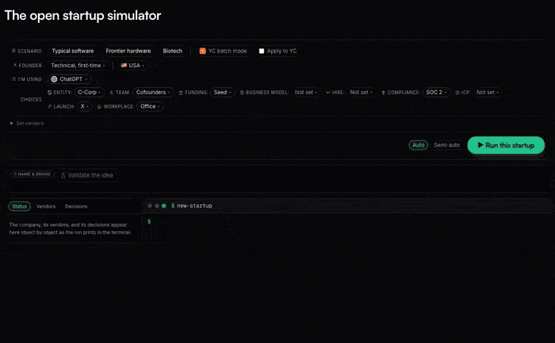
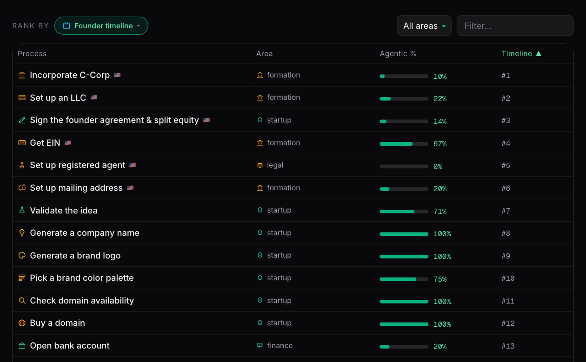
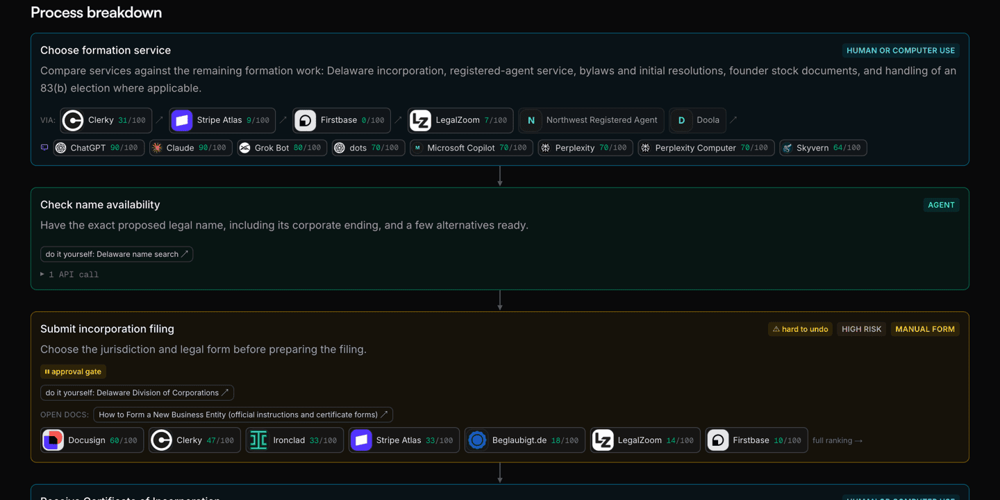
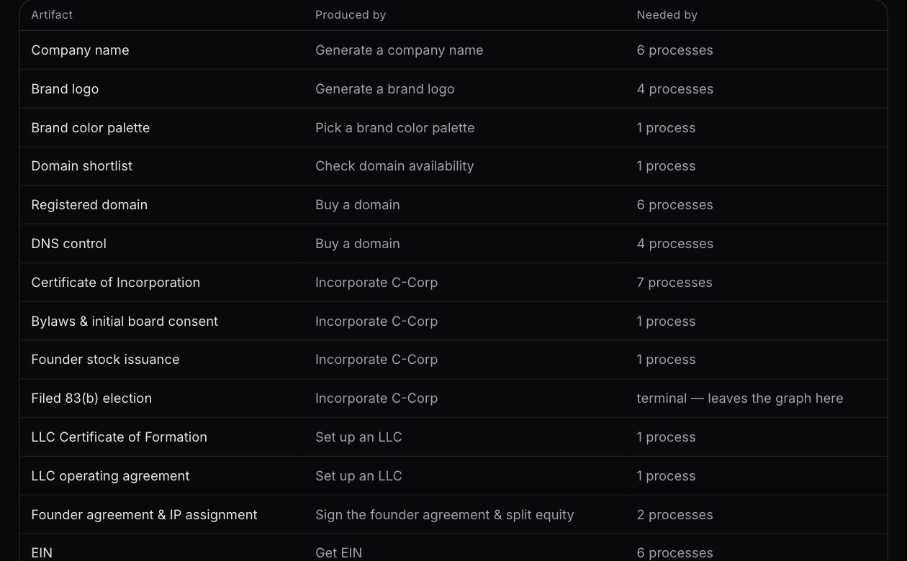
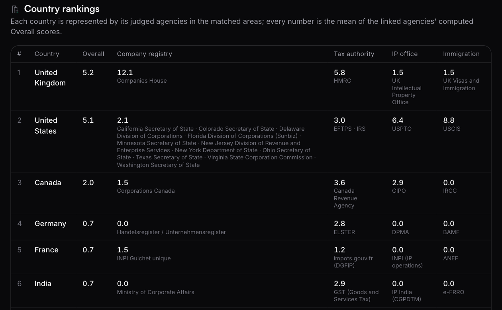
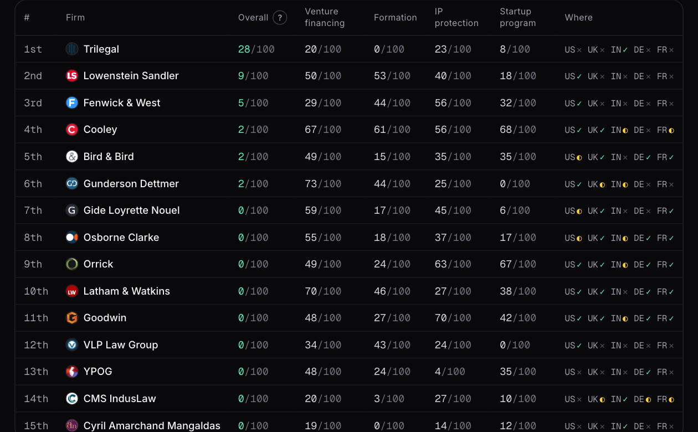
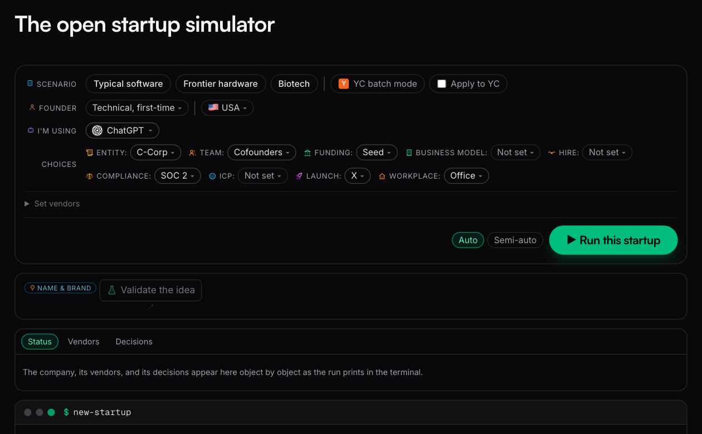

[](https://discord.gg/3aHky836qP)

**The open repo for the whole startup journey in the agentic era.**

Navigate all business processes, compare and select AI native vendors, inform yourself on startup lore, run open modules to become vendor free, save money using open documentation. Help future founders by making PRs to the open artifacts, gaps in open documents or improve the open module logic. Let's make it easy to start and run a startup around the world.

<pre>
ultrametric/
├── <a href="#open-vendor-rankings">open-rankings</a>/      per-market products, stories, evidence, verdicts
├── <a href="#open-processes">open-processes</a>/     founder processes and situations as routed, timed steps
├── <a href="#open-modules">open-modules</a>/       worked guides to each startup calculation
├── <a href="#open-startup-simulator">open-startup-sim</a>/   what the simulator runs and assumes
├── <a href="#open-law">open-law</a>/           startup legal rules by jurisdiction, the distilled laws
├── <a href="#open-lore">open-lore</a>/          founder advice and stories, who said it, the reading library
├── <a href="#open-docs">open-documents</a>/     openly published legal documents, by use case
├── <a href="#open-artifacts">open-artifacts</a>/     the business objects processes exchange, with field standards
├── rankings-engine/    the code that crawls, probes, judges, scores
├── lib/                loaders, scoring, the calculation and simulator code
├── jurisdictions/      country and state data, vendor availability
├── coverage/           what each area covers and what is missing
├── schemas/            the JSON shape each data file validates against
└── policies/           how records are reviewed and what agents may do here
</pre>

<!-- Legacy anchor: external links to #start-here predate the merge into this map. -->
<a id="start-here"></a>

Supporting founders globally: 🌐 🇺🇸 🇬🇧 🇮🇳 🇩🇪 🇫🇷 🇵🇹 🇨🇦

[](https://ultrametric.ai)

<a id="vendors"></a>

## Open vendor rankings

We've looked at all the tools and vendors needed for founders to start and operate their company. Vendors are then ranked in terms of how easy it is for your AI to access and control them. From business banking, to payroll, to gov services for filing tax or your trademark. We want to know what claims match reality and who is the most AI native when it comes to their APIs, CLIs, MCPs and computer use surface area.

Example rankings:

- [Startup banking](https://ultrametric.ai/arena/startup-banking) — business bank accounts ranked on agent access, from opening the account to moving money
- [Cap table & equity](https://ultrametric.ai/arena/equity-management) — cap table platforms ranked on how well an agent can read and update the cap table
- [Startup legal & incorporation](https://ultrametric.ai/arena/legal-ops) — formation services ranked on agent access to incorporation, filings, and the documents they produce
- [Online payments](https://ultrametric.ai/arena/payments) — payment processors ranked on how well an agent can integrate and operate them
- [Email marketing](https://ultrametric.ai/arena/email-marketing) — campaign platforms ranked on agent control of audiences, sends, and results
- [CRM](https://ultrametric.ai/arena/crm) — customer systems ranked on what an agent can read, write, and automate
- [Government services](https://ultrametric.ai/arena/government-services) — the IRS, Companies House, HMRC and other agencies, judged like vendors, compared per country

The [full index of ranked markets](https://ultrametric.ai/arenas) is live, and the data behind each board lives under [`open-rankings/`](open-rankings/).

[](https://ultrametric.ai/overall)

[Add your vendor](CONTRIBUTING.md#add-your-vendor)

<a id="processes"></a>

## Open processes

The founder [processes](open-processes/) are written step by step. Each step is routed agent, form, or
human, timed, and marked by how hard it is to undo. The vendors that can run a step are
listed on it, with their judged scores. See it live at
[ultrametric.ai/processes](https://ultrametric.ai/processes).

[](https://ultrametric.ai/processes)

### Examples

- [Incorporate C-Corp](https://ultrametric.ai/processes/incorporate-c-corp) — set up a Delaware C-corp, filing to signed 83(b)
- [Get a 409A valuation](https://ultrametric.ai/processes/get-a-409a-valuation) — establish the fair market value for stock options
- [Set up mailing address](https://ultrametric.ai/processes/set-up-mailing-address) — a business mailing address for legal and banking purposes

[](https://ultrametric.ai/processes/incorporate-c-corp)

<!-- Legacy anchor: external links to #business-logic predate the open-modules/ rename. -->
<a id="business-logic"></a>

## Open modules

The standard startup calculations are ready to run: cap table math, SAFE conversion,
dilution, sale waterfalls, runway, vesting, option tax, and filing deadlines. The code
lives in [`lib/openstartup/`](lib/openstartup/), and you can run and check it. Formulas
cite their sources and replay the published worked examples in tests.

The catalog is organized into four groups; the Serves column names the processes each
module computes for, written from the committed module-to-process map by
`scripts/generate-business-logic-serves.ts`.

### Formation & equity

| Module | What it computes | Serves |
| --- | --- | --- |
| [Cap table](open-modules/README.md#cap-table) | Issuance, option pools, SAFE conversion, priced-round price per share, dilution | Incorporate C-Corp · Sign the founder agreement & split equity · Set up cap table · Update cap table · Audit cap table · Raise pre-seed (SAFEs) · Close a priced equity round · Issue stock options · Convert SAFEs at the priced round · Handle a co-founder departure |
| [Vesting](open-modules/README.md#vesting-mechanics) | Cliff and periodic schedules, back-loaded tranches, acceleration, departures | Incorporate C-Corp · Sign the founder agreement & split equity · Issue stock options · Hire first employee · Hire an executive · Handle a co-founder departure |
| [83(b) election](open-modules/README.md#83b-election-math) | Tax at grant vs tax at vesting, forfeiture cost | Incorporate C-Corp · Sign the founder agreement & split equity · Convert an LLC to a C-Corp |
| [QSBS (§ 1202)](open-modules/README.md#qsbs--1202) | Eligibility conditions, holding clock, exclusion percentages, per-issuer cap | Incorporate C-Corp · Convert an LLC to a C-Corp |
| [Equity comp](open-modules/README.md#offer--equity-comp-scenarios) | Offer grant percentage, option spread, exit scenarios | Issue stock options · Hire first employee · Hire an executive |
| [Option tax](open-modules/README.md#iso--nso-exercise-tax) | NSO income at exercise, ISO/AMT outcomes, the $100,000 limit, sale outcomes | Issue stock options · Offboard employee |
| [409A](open-modules/README.md#409a-grant-sanity) | Strike floor, valuation staleness, presumption timing | Close a priced equity round · Get a 409A valuation · Issue stock options |

### Fundraising & exits

| Module | What it computes | Serves |
| --- | --- | --- |
| [Convertible notes](open-modules/README.md#convertible-notes) | Interest accrual, cap/discount conversion, maturity paths | Raise pre-seed (SAFEs) · Convert SAFEs at the priced round |
| [Priced round](open-modules/README.md#priced-round-mechanics) | Pro rata, pool sizing from a hiring plan, down rounds, secondaries | Close a priced equity round · Convert SAFEs at the priced round |
| [Round composer](open-modules/README.md#priced-round-composer) | A priced round end to end, term sheet to post-close table | Close a priced equity round · Convert SAFEs at the priced round |
| [Anti-dilution](open-modules/README.md#anti-dilution) | Weighted-average and full-ratchet adjustments | Close a priced equity round |
| [Sale waterfall](open-modules/README.md#liquidity-event-waterfall) | Per-holder proceeds at a sale price | Raise pre-seed (SAFEs) · Close a priced equity round |

### Tax & compliance

| Module | What it computes | Serves |
| --- | --- | --- |
| [Deadlines](open-modules/README.md#deadline-calendar) | The founder compliance calendar, each date citing a rule card | Incorporate C-Corp · Sign the founder agreement & split equity · Convert an LLC to a C-Corp · File DE franchise tax · File federal tax return · Cure a Delaware franchise tax delinquency |
| [Payroll tax](open-modules/README.md#employer-payroll-tax) | Employer FICA/FUTA load, per-employee annual cost | Set up payroll · Hire first employee · Run payroll |
| [Delaware franchise tax](open-modules/README.md#delaware-franchise-tax) | Both published methods, the cheaper-method comparison | File DE franchise tax · Cure a Delaware franchise tax delinquency |
| [R&D tax](open-modules/README.md#rd-tax-mechanics) | § 174 amortization, § 41(h) payroll-offset mechanics | Claim the R&D tax credit |

### Finance & runway

| Module | What it computes | Serves |
| --- | --- | --- |
| [Runway](open-modules/README.md#runway--burn) | Default-alive trajectories, hiring impact | Track runway · Send the board financial report · Set the annual budget & get board approval |
| [Unit economics](open-modules/README.md#unit-economics) | LTV/CAC, burn multiple, Rule of 40, magic number | Track runway · Send the board financial report · Prepare a board meeting · Save a churning customer · Roll out a pricing change |
| [Deferred revenue](open-modules/README.md#deferred-revenue-subscriptions) | Subscription revenue recognition, plan-change proration | Bookkeeping close · Set up subscription billing · Roll out a pricing change |

[`open-modules/README.md`](open-modules/README.md) has each module's contract, worked
examples, and boundaries.

### Shared data fields

The modules and processes read one shared set of company fields: incorporation date,
authorized shares, par value, cash on hand, the common-share FMV. Each field is
registered in [`open-artifacts/fields.json`](open-artifacts/fields.json), so the
same value feeds the modules that need it. The data shapes are published as JSON
Schemas in [`schemas/`](schemas/).

## Open artifacts

Artifacts are the documents and files that processes produce and consume: the certificate of
incorporation, the EIN letter, the cap table. Each is registered in
[`open-artifacts/registry.json`](open-artifacts/registry.json), so the processes declare what
they make and what they need. The typed data fields those artifacts establish (the EIN, the
incorporation date, the file number) are specified in
[`open-artifacts/fields.json`](open-artifacts/fields.json), each with its format, defining
authority, and per-country equivalents; [`open-artifacts/README.md`](open-artifacts/README.md)
is the guide. See it live at
[ultrametric.ai/artifacts](https://ultrametric.ai/artifacts).

[](https://ultrametric.ai/artifacts)

<!-- Legacy anchor: inbound links to #open-docs predate the fold under Open artifacts. -->
<a id="open-docs"></a>

### Open docs

The openly published startup legal [documents](open-documents/) are collected and grouped
by what they are for. Each entry links the publisher's live page and carries the date it was last
checked. Known gaps are recorded too. See it live at
[ultrametric.ai/open-documents](https://ultrametric.ai/open-documents).

| Category | Example documents |
| --- | --- |
| Formation | [Cooley GO Delaware incorporation package](https://www.cooleygo.com/documents/incorporation-package-delaware/), [IRS Form SS-4](https://www.irs.gov/pub/irs-pdf/fss4.pdf) |
| Fundraising | [YC post-money SAFEs, User Guide, and pro rata side letter](https://www.ycombinator.com/documents) |
| Governance | [Orrick Delaware incorporation toolkit](https://www.orrick.com/en/tech-studio/forms/Incorporation-Toolkit), [cap table template](https://www.orrick.com/en/tech-studio/forms/Capitalization-Table) |
| Hiring | [Offer letter](https://www.cooleygo.com/documents/form-employee-offer-letter/), [CIIAA/PIIA](https://www.cooleygo.com/documents/form-employee-confidential-information-inventions-assignment-agreement/), [Balanced Employee IP Agreement](https://github.com/github/balanced-employee-ip-agreement) |
| Commercial | [Cloud service agreement](https://commonpaper.com/standards/cloud-service-agreement/), [terms of service](https://commonpaper.com/standards/terms-of-service/), [SLA](https://commonpaper.com/standards/service-level-agreement/) |
| Privacy | [DPA](https://commonpaper.com/standards/data-processing-agreement/), [BAA](https://commonpaper.com/standards/business-associate-agreement/), [AI addendum](https://commonpaper.com/standards/ai-addendum/) |
| Open-source | [Apache ICLA](https://www.apache.org/licenses/icla.pdf), [Developer Certificate of Origin](https://developercertificate.org/) |

<!-- Legacy anchor: inbound links to #situations predate the open- family rename. -->
<a id="situations"></a>

## Open situations

[Unplanned events](open-processes/SITUATIONS.md) are routed into the process graph: a breach, a
summons, a tax notice. Each names what triggers it, how fast you must act (hours, days, or
weeks), and the steps that run, routed agent, form, or human like any process. See it live
at [ultrametric.ai/situations](https://ultrametric.ai/situations).

[](https://ultrametric.ai/situations)

<a id="add-your-country-or-state"></a>

### Example: Founder country switch

Processes and vendor availability adapt to where you operate. The US is the baseline;
the UK, India, Germany, France, Portugal, and Canada have country analogs with official
filing links. Adding your country is a pull request that the data checks validate
automatically.

- [Get EIN](https://ultrametric.ai/processes/get-ein) — in the UK, France, Portugal, and Canada the tax ID arrives automatically with incorporation; in Germany it is its own filing with the tax office
- [Set up an LLC](https://ultrametric.ai/processes/set-up-an-llc) — the analog shifts by country (LLP in the UK and India, UG in Germany, SARL in France) and Canada has no LLC at all

## Open lore

Lore is the [advice](open-lore/) founders actually pass around and the [stories](open-lore/LORE.md)
behind it: who said it, where it is written down, and how well documented it is. When the
schools disagree, both sides are recorded. The [library](open-lore/library.json) collects the
best essays, guides, books, and talks, organized from deciding to start through getting
acquired.

| Section | What it teaches | Example entry |
| --- | --- | --- |
| Deciding to start | Whether to start a startup at all: the case for building, the cost of the bargain, and the mindset that survives it. | [How to Make Wealth](https://paulgraham.com/wealth.html) — Paul Graham |
| Ideas and markets | Finding an idea worth working on, judging the market it lives in, and choosing the scale of ambition. | [How to Get Startup Ideas](https://paulgraham.com/startupideas.html) — Paul Graham |
| Starting up | The first months of a company: the condensed playbooks, the accelerator application, and the mistakes that kill early startups. | [How to Start a Startup](https://paulgraham.com/start.html) — Paul Graham |
| Co-founders and founding decisions | Picking co-founders, splitting equity, naming, and the setup decisions made once: incorporation, banking, cap table, visas, and where to build. The readings are US-centric. | [How to pick a co-founder](https://venturehacks.com/pick-cofounder) — Naval Ravikant |
| Finding product-market fit | Talking to users, shipping a minimum product, and measuring whether the market pulls. | [The Only Thing That Matters](https://pmarchive.com/guide_to_startups_part4.html) — Marc Andreessen |
| Building the product | Scoping the MVP, product design and UX, and the engineers who ship it. | [Getting Real](https://basecamp.com/gettingreal) — Jason Fried, David Heinemeier Hansson, and Matt Linderman |
| Fundraising | Raising seed and priced rounds: instruments, term sheets, pitching, investor emails, and runway math. The instruments and norms described are US-centric. | [How to Raise Money](https://paulgraham.com/fr.html) — Paul Graham |
| Hiring and culture | Recruiting, interviewing, compensation, and the cultures teams are built on. | [How to Hire](https://blog.samaltman.com/how-to-hire) — Sam Altman |
| Operating | Running the company: management systems, founder time, prioritization, and pace. | [High Output Management](https://www.penguinrandomhouse.com/books/72467/high-output-management-by-andrew-s-grove-former-chairman-and-ceo-of-intel/) — Andrew S. Grove |
| Growth and distribution | First users, growth loops, channel decay, and when to scale spend and headcount. | [Startup = Growth](https://paulgraham.com/growth.html) — Paul Graham |
| Pricing and sales | Setting and raising prices, founder-led selling, and building the first sales team. | [Why Your Customers Would Be Happier If You Charged More](https://www.kalzumeus.com/2012/09/21/ramit-sethi-and-patrick-mckenzie-on-why-your-customers-would-be-happier-if-you-charged-more/) — Patrick McKenzie with Ramit Sethi |
| Exits and acquisitions | Deciding whether to sell, running an acquisition process, and life after the deal. | [Notes on the Acquisition Process](https://cdixon.org/2012/09/10/notes-on-the-acquisition-process/) — Chris Dixon |

### Example: Getting acquired

The mechanics are extracted from the essays, each tied to its source: contested claims in
the [registry](open-lore/registry.json) with their tensions mapped, uncontested rules in
[rules.json](open-lore/rules.json), and the works themselves in the
[library](open-lore/library.json). From Justin Kan's
[The Founder's Guide to Selling Your Company](https://web.archive.org/web/20181123041114/https://justinkan.com/the-founders-guide-to-selling-your-company-a1b2025c9481):
an offer is real only when it carries an expiration date or a term sheet promised within
24-48 hours; once committed to a sale, share diligence data freely under an NDA and refuse
acquirer interviews of your team; leverage ends at the term sheet, so settle the points and
a short close (target 30 days) before signing. Where the canon disagrees, both sides are
linked as a tension: Horowitz's case for the fat startup (in a big market, outspending
beats running lean) against Ries's lean loop, and Kan's sell-from-strength against Cohen's
rich-versus-king. The acquisition stories (WhatsApp, Twitch, MySpace) are in
[`open-lore/LORE.md`](open-lore/LORE.md) with lessons and sources, and the waterfall
module computes who gets what at any price. The acquisition playbook process is a known,
open gap.

## Open law

Map the [law](open-law/) that applies to startups, across jurisdictions, and connect it to
the processes, calculations, and vendors that act on it. Each legal statement is one dated
rule card citing a primary [authority](open-law/citations/) (a statute, regulation, or
agency page) with the exact section. A blog post cannot establish law. The cards are scoped
by jurisdiction: [federal](open-law/US-FED/), [Delaware](open-law/US-DE/),
[California](open-law/US-CA/), [Nevada](open-law/US-NV/), [New York](open-law/US-NY/),
[Texas](open-law/US-TX/), [Washington](open-law/US-WA/), and the [EU](open-law/EU/). The
distilled [startup laws](open-law/LAWS.md) collect the recurring principles the reading
canon keeps re-teaching, grouped by lifecycle stage from
[idea](open-law/LAWS.md#idea-and-validation) through
[survival](open-law/LAWS.md#survival-and-the-long-game), each citing its sources. The
[domain map](open-law/README.md#the-map) ties each legal area to the rule cards covering
it and the processes it governs, graded mapped, partial, or unmapped.

### Example: The 83(b) election

One rule, followed through the repo. The distilled law states the thirty-day window
([Formation and housekeeping](open-law/LAWS.md#formation-and-housekeeping)); its rule card
[`us-fed.83b-filing-period`](open-law/US-FED/us-fed-83b-filing-period.json) pins the IRS
procedure; the [Incorporate C-Corp](https://ultrametric.ai/processes/incorporate-c-corp)
process signs and files the election as explicit steps, with the jurisdiction-scoped
workflow [`equity.us-de.83b-election`](open-processes/equity/us-de/83b-election.json)
requiring a named human approval on the filing; and the
[83(b) election math module](open-modules/README.md#83b-election-math) computes
tax-at-grant against tax-at-vesting, replaying the IRS revenue-procedure examples in
tests.

## Government services and startups

Government [agencies](open-rankings/government-services/) are judged like vendors: the IRS,
Companies House, HMRC, the Handelsregister. Per-country boards compare how well each
agency works for a founder or an agent. See it live at
[ultrametric.ai/arena/government-services](https://ultrametric.ai/arena/government-services).

[](https://ultrametric.ai/arena/government-services)

## Startup ecosystem

The service providers around a startup (law firms, immigration counsel, accountants,
banks) are ranked in their own markets and wired to the process steps they serve. See the
law firms live at
[ultrametric.ai/rankings/law-firms](https://ultrametric.ai/rankings/law-firms).

[](https://ultrametric.ai/rankings/law-firms)

## Open startup simulator

A simulated company runs the whole process library end to end, and everything it
generates is visibly marked simulated.

[](https://ultrametric.ai/startup-sim)

<a id="for-ai-agents"></a>
<a id="use-it-from-an-agent"></a>

## Stages

Each lifecycle stage cuts across the repo: the processes to run, the vendor markets to
pick from, the modules that do the math, the artifacts produced, and the lore and law
behind the decisions. Two stages as examples:

### Stage: Formation

- Process: [Incorporate C-Corp](https://ultrametric.ai/processes/incorporate-c-corp) — filing to signed 83(b)
- Vendors: [startup legal & incorporation](https://ultrametric.ai/arena/legal-ops) and [startup banking](https://ultrametric.ai/arena/startup-banking)
- Modules: [cap table](open-modules/README.md#cap-table) and [83(b) election math](open-modules/README.md#83b-election-math)
- Artifacts: the certificate of incorporation and EIN letter in the [registry](open-artifacts/registry.json), establishing the incorporation-date and EIN [fields](open-artifacts/fields.json)
- Lore: the [library's](open-lore/library.json) co-founders and founding-decisions readings, distilled in [formation and housekeeping](open-law/LAWS.md#formation-and-housekeeping)
- Law: the [Delaware incorporation cards](open-law/US-DE/) and the [83(b) filing period](open-law/US-FED/us-fed-83b-filing-period.json)

### Stage: Growth

- Processes: [set up email marketing](https://ultrametric.ai/processes/set-up-email-marketing) and [build an SEO & content engine](https://ultrametric.ai/processes/build-an-seo-content-engine)
- Vendors: [email marketing](https://ultrametric.ai/arena/email-marketing) and [CRM](https://ultrametric.ai/arena/crm)
- Module: [runway & burn](open-modules/README.md#runway--burn) — default-alive trajectories as spend scales
- Artifacts: the marketing email audience and subscription billing in the [registry](open-artifacts/registry.json)
- Lore: the [library's](open-lore/library.json) growth and distribution readings, distilled in [growth, people and spending](open-law/LAWS.md#growth-people-and-spending)
- Law: the [CAN-SPAM requirements](open-law/US-FED/us-fed-can-spam-requirements.json) on the sends

<a id="install-ultrametric"></a>

## Install Ultrametric into your agent

Ultrametric is available as a hosted service to integrate directly into your agent
of choice. The MCP or CLI allows agents to find, read, and start processes as well
as keep track of company information across agents.

The simplest way to get started is to copy and paste
`set up https://ultrametric.ai/install` into your agent, it will walk you through
the rest.

### CLI

The CLI requires Node.js 22.12 or later. Install it and sign in through the browser:

```bash
npm install -g ultrametric@latest
ultrametric auth login
```

Follow the [CLI installation and sign-in guide](https://docs.ultrametric.ai/cli/install)
for setup through a terminal agent.

### Hosted MCP

In an AI application that supports remote MCP and OAuth, add this server URL in
its MCP connection settings:

```text
https://api.ultrametric.ai/mcp
```

Complete the application's sign-in flow and choose your Ultrametric account and
organization.

Follow the [MCP connection guide](https://docs.ultrametric.ai/mcp/connect) for setup
and the [MCP tool reference](https://docs.ultrametric.ai/mcp/tools) for available operations.

## License

Code is Apache-2.0 ([LICENSE](./LICENSE)); the data is viewable and quotable with
attribution, and bulk reuse needs written permission ([DATA-LICENSE](./DATA-LICENSE)).
