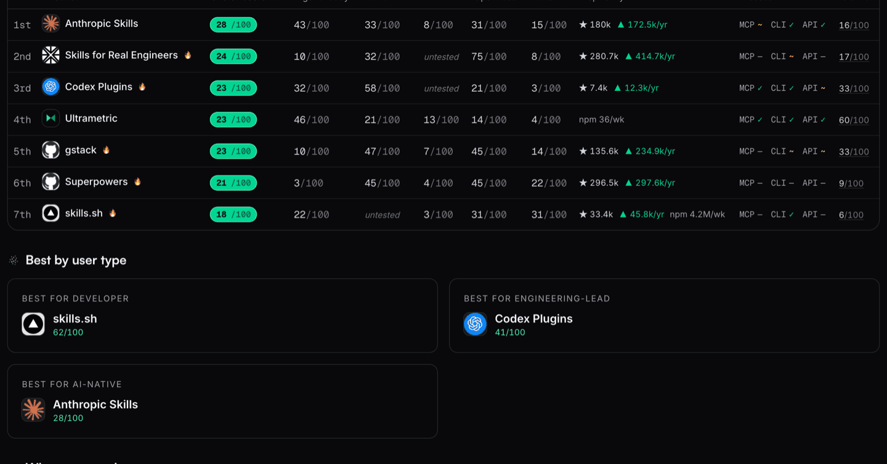

Ultrametric is the open startup repo: every
founder [process](#open-processes) step by step, the [tools](#open-vendor-rankings) and
the [service providers](#startup-ecosystem) around a company (law firms included) ranked
by how well an agent can drive them, [company law](#open-law) mapped across
jurisdictions, the [lore](#open-lore) and its library recorded with sources, the open
[documents and artifacts](#open-artifacts) collected, the startup
[calculations](#open-modules) as tested code, all of it replayable in the
[simulator](https://ultrametric.ai/startup-sim) and readable by
[agents](#install-ultrametric) without keys. The aim: make starting and running a
company agentic, automated, and standardized across geographies.

```
ultrametric/
├── processes/       every founder process, step by step
├── rankings/        evidence, verdicts, computed scores
├── pipeline/        crawl, probe, judge, derive
├── open-modules/    the startup calculations, indexed
├── lib/             the code behind modules and loaders
├── law/             startup law, one rule per record
├── citations/       the sources every record cites
├── jurisdictions/   countries, states, vendor geography
├── open-documents/  the open legal documents catalog
├── lore/            heuristics, episodes, the library
├── coverage/        what is covered, at what maturity
├── schemas/         the JSON contracts for every record
└── governance/      review, evidence, and agent policy
```

**Community:** [Discord](https://discord.com/invite/3aHky836qP) — founders and contributors

<!-- Legacy anchor: external links to #start-here predate the merge into this map. -->
<a id="start-here"></a>

[](https://ultrametric.ai)

## The open startup repo

This repo holds the processes, rankings, law, and calculations a startup runs on, as
plain JSON and markdown that any founder or agent can read, verify, and correct by pull
request. The site at ultrametric.ai renders it unchanged.

<a id="vendors"></a>

## Open vendor rankings

The tools startups run on, examined through an agentic lens: can an agent actually drive
each one, is it testable, and do the vendor's claims match what we found hands-on. The
rankings order products by how automatable they are, and every verdict can be contested.

<!-- arenas:start -->
**96 rankings** today, 670 products judged head to head — the full index is [ultrametric.ai/arenas](https://ultrametric.ai/arenas), and each ranking's records live under [`rankings/`](rankings/).
<!-- arenas:end -->

[](https://ultrametric.ai/overall)

[Add your vendor](CONTRIBUTING.md#add-your-vendor)

<a id="processes"></a>

## Open processes

Every founder [process](processes/), step by step. Each step is routed agent, form, or
human, timed, and marked by how hard it is to undo. The vendors that can run a step are
listed on it, with their judged scores. See it live at
[ultrametric.ai/processes](https://ultrametric.ai/processes).

[](https://ultrametric.ai/processes)

### Examples

- [Incorporate C-Corp](https://ultrametric.ai/processes/incorporate-c-corp) — set up a Delaware C-corp, filing to signed 83(b)
- [Get a 409A valuation](https://ultrametric.ai/processes/get-a-409a-valuation) — establish the fair market value for stock options
- [Set up mailing address](https://ultrametric.ai/processes/set-up-mailing-address) — a business mailing address for legal and banking purposes

[](https://ultrametric.ai/processes/incorporate-c-corp)

[Add a process](CONTRIBUTING.md#add-a-process)

<!-- Legacy anchor: external links to #business-logic predate the open-modules/ rename. -->
<a id="business-logic"></a>

## Open modules

The standard startup calculations, ready to run: cap table math, SAFE conversion,
dilution, sale waterfalls, runway, vesting, option tax, and filing deadlines. The code
lives in [`lib/openstartup/`](lib/openstartup/), and you can run and check it. Every
formula cites its source and replays the published worked examples in tests.

| Module | What it computes |
| --- | --- |
| [Cap table](open-modules/README.md#cap-table) | Issuance, option pools, SAFE conversion, priced-round price per share, dilution |
| [Vesting](open-modules/README.md#vesting-mechanics) | Cliff and periodic schedules, back-loaded tranches, acceleration, departures |
| [83(b) election](open-modules/README.md#83b-election-math) | Tax at grant vs tax at vesting, forfeiture cost |
| [QSBS (§ 1202)](open-modules/README.md#qsbs--1202) | Eligibility conditions, holding clock, exclusion percentages, per-issuer cap |
| [Deadlines](open-modules/README.md#deadline-calendar) | The founder compliance calendar, each date citing a rule card |
| [Convertible notes](open-modules/README.md#convertible-notes) | Interest accrual, cap/discount conversion, maturity paths |
| [Sale waterfall](open-modules/README.md#liquidity-event-waterfall) | Per-holder proceeds at a sale price |
| [Anti-dilution](open-modules/README.md#anti-dilution) | Weighted-average and full-ratchet adjustments |
| [Priced round](open-modules/README.md#priced-round-mechanics) | Pro rata, pool sizing from a hiring plan, down rounds, secondaries |
| [Round composer](open-modules/README.md#priced-round-composer) | A priced round end to end, term sheet to post-close table |
| [409A](open-modules/README.md#409a-grant-sanity) | Strike floor, valuation staleness, presumption timing |
| [Equity comp](open-modules/README.md#offer--equity-comp-scenarios) | Offer grant percentage, option spread, exit scenarios |
| [Option tax](open-modules/README.md#iso--nso-exercise-tax) | NSO income at exercise, ISO/AMT outcomes, the $100,000 limit, sale outcomes |
| [Payroll tax](open-modules/README.md#employer-payroll-tax) | Employer FICA/FUTA load, per-employee annual cost |
| [Delaware franchise tax](open-modules/README.md#delaware-franchise-tax) | Both published methods, the cheaper-method comparison |
| [R&D tax](open-modules/README.md#rd-tax-mechanics) | § 174 amortization, § 41(h) payroll-offset mechanics |
| [Runway](open-modules/README.md#runway--burn) | Default-alive trajectories, hiring impact |
| [Unit economics](open-modules/README.md#unit-economics) | LTV/CAC, burn multiple, Rule of 40, magic number |
| [Deferred revenue](open-modules/README.md#deferred-revenue-subscriptions) | Subscription revenue recognition, plan-change proration |

[`open-modules/README.md`](open-modules/README.md) has each module's contract, worked
examples, and boundaries.

### Shared data fields

The modules and processes read one shared set of company fields: incorporation date,
authorized shares, par value, cash on hand, the common-share FMV. Each field is
registered in [`processes/company-fields.json`](processes/company-fields.json), so the
same value feeds every module that needs it. Every record shape is published as a JSON
Schema in [`schemas/`](schemas/).

[Add an open module](CONTRIBUTING.md#add-an-open-module)

## Open artifacts

The documents and records that processes produce and consume: the certificate of
incorporation, the EIN letter, the cap table. Each is registered in
[`processes/artifacts.json`](processes/artifacts.json), so every process declares what
it makes and what it needs. See it live at
[ultrametric.ai/artifacts](https://ultrametric.ai/artifacts).

[](https://ultrametric.ai/artifacts)

<!-- Legacy anchor: inbound links to #open-docs predate the fold under Open artifacts. -->
<a id="open-docs"></a>

### Open docs

The openly published startup legal [documents](open-documents/), grouped by what they
are for. Each entry links the publisher's live page and carries the date it was last
checked. Known gaps are recorded too. See it live at
[ultrametric.ai/open-documents](https://ultrametric.ai/open-documents).

| Category | Example documents |
| --- | --- |
| Formation | [Cooley GO Delaware incorporation package](https://www.cooleygo.com/documents/incorporation-package-delaware/), [IRS Form SS-4](https://www.irs.gov/pub/irs-pdf/fss4.pdf) |
| Fundraising | [YC post-money SAFEs, User Guide, and pro rata side letter](https://www.ycombinator.com/documents) |
| Governance | [Orrick Delaware incorporation toolkit](https://www.orrick.com/en/tech-studio/forms/Incorporation-Toolkit), [cap table template](https://www.orrick.com/en/tech-studio/forms/Capitalization-Table) |
| Hiring | [Offer letter](https://www.cooleygo.com/documents/form-employee-offer-letter/), [CIIAA/PIIA](https://www.cooleygo.com/documents/form-employee-confidential-information-inventions-assignment-agreement/), [Balanced Employee IP Agreement](https://github.com/github/balanced-employee-ip-agreement) |
| Commercial | [Cloud service agreement](https://commonpaper.com/standards/cloud-service-agreement/), [terms of service](https://commonpaper.com/standards/terms-of-service/), [SLA](https://commonpaper.com/standards/service-level-agreement/) |
| Privacy | [DPA](https://commonpaper.com/standards/data-processing-agreement/), [BAA](https://commonpaper.com/standards/business-associate-agreement/), [AI addendum](https://commonpaper.com/standards/ai-addendum/) |
| Open-source | [Apache ICLA](https://www.apache.org/licenses/icla.pdf), [Developer Certificate of Origin](https://developercertificate.org/) |

## Situations

[Guides](processes/SITUATIONS.md) for reactive work: a breach is live, a summons lands,
a tax notice arrives. Each names its trigger and an urgency clock of hours, days, or
weeks. See it live at [ultrametric.ai/situations](https://ultrametric.ai/situations).

[](https://ultrametric.ai/situations)

<a id="add-your-country-or-state"></a>

### Example: Founder country switch

Processes and vendor availability adapt to where you operate. The US is the baseline;
the UK, India, Germany, France, Portugal, and Canada have country analogs with official
filing links. Adding your country is a pull request that the data checks validate
automatically.

- [Get EIN](https://ultrametric.ai/processes/get-ein) — in the UK, France, Portugal, and Canada the tax ID arrives automatically with incorporation; in Germany it is its own filing with the tax office
- [Set up an LLC](https://ultrametric.ai/processes/set-up-an-llc) — the analog shifts by country (LLP in the UK and India, UG in Germany, SARL in France) and Canada has no LLC at all

[Add a jurisdiction](CONTRIBUTING.md#add-a-jurisdiction)

## Open lore

The [advice](lore/) founders actually pass around, and the [episodes](lore/LORE.md) behind
it: who said it, where it is written down, and how well documented it is. When the
schools disagree, both sides are recorded. The [library](lore/library.json) collects the
best essays, guides, books, and talks, organized from starting up through getting
acquired.

| Section | What it teaches | Example entry |
| --- | --- | --- |
| Starting up and ideas | Deciding to start, finding an idea worth working on, and the first weeks of a company. | [How to Start a Startup](https://paulgraham.com/start.html) — Paul Graham |
| Finding product-market fit | Talking to users, shipping a minimum product, and measuring whether the market pulls. | [The Only Thing That Matters](https://pmarchive.com/guide_to_startups_part4.html) — Marc Andreessen |
| Fundraising | Raising seed and priced rounds: instruments, term sheets, pitching, and runway math. | [How to Raise Money](https://paulgraham.com/fr.html) — Paul Graham |
| Hiring and culture | Recruiting, interviewing, compensation, and the management systems that scale a team. | [How to Hire](https://blog.samaltman.com/how-to-hire) — Sam Altman |
| Growth and distribution | First users, growth loops, channel decay, and when to scale spend and headcount. | [Startup = Growth](https://paulgraham.com/growth.html) — Paul Graham |
| Pricing and sales | Setting and raising prices, founder-led selling, and building the first sales team. | [Why Your Customers Would Be Happier If You Charged More](https://www.kalzumeus.com/2012/09/21/ramit-sethi-and-patrick-mckenzie-on-why-your-customers-would-be-happier-if-you-charged-more/) — Patrick McKenzie with Ramit Sethi |
| Exits and acquisitions | Deciding whether to sell, running an acquisition process, and life after the deal. | [Notes on the Acquisition Process](https://cdixon.org/2012/09/10/notes-on-the-acquisition-process/) — Chris Dixon |

### Example: Getting acquired

The acquisition episodes are recorded lore: WhatsApp, Twitch, and MySpace are in
`lore/LORE.md`, each with its lesson and sources. The sale math is live; the
waterfall module computes who gets what at any price. The acquisition playbook itself is
a mapped, open gap in [`coverage/`](coverage/).

## Open law

Map the [law](law/) that applies to startups, across jurisdictions, and connect it to
the calculations and the vendors that act on it. Each legal statement is one dated record
citing a primary [authority](citations/) (a statute, regulation, or agency page) with the
exact section. A blog post cannot establish law.

## Government services and startups

Government [agencies](rankings/government-services/) are judged like vendors: the IRS,
Companies House, HMRC, the Handelsregister. Per-country boards compare how well each
agency works for a founder or an agent. See it live at
[ultrametric.ai/arena/government-services](https://ultrametric.ai/arena/government-services).

## Startup ecosystem

The service providers around a startup (law firms, immigration counsel, accountants,
banks) are ranked in their own markets and wired to the process steps they serve. See the
law firms live at
[ultrametric.ai/arena/startup-law-firms](https://ultrametric.ai/arena/startup-law-firms).

## Open startup simulator

A simulated company runs the whole process library end to end. Every step is routed
agent, form, or human, and everything it generates is visibly marked simulated.

[](https://ultrametric.ai/startup-sim)

## Open skills for startups

`ultrametric init` installs the bundled agent skill
([install guide](https://docs.ultrametric.ai/cli/install)), so a coding agent can
retrieve a process, run the agent-routed steps, and save progress from inside your repo.
Skill collections themselves are a judged market: see it live at
[ultrametric.ai/arena/agent-skills](https://ultrametric.ai/arena/agent-skills).

[](https://ultrametric.ai/arena/agent-skills)

<a id="for-ai-agents"></a>
<a id="use-it-from-an-agent"></a>

## Install Ultrametric

One npm package ships the CLI and MCP server; the data itself needs no install and no
keys.

```bash
npm install -g ultrametric@latest                   # CLI + MCP server + agent skill
curl https://ultrametric.ai/data/categories.json    # every ranking, raw JSON
curl https://ultrametric.ai/llms.txt                # the index for agents
```

[ultrametric.ai/get-started](https://ultrametric.ai/get-started) · [docs.ultrametric.ai](https://docs.ultrametric.ai)

## Methodology

Every score is computed from dated, cited evidence. An unknown is shown as unknown, not
zero. Negative results stay published, a score cannot move without new evidence, and the
founders' own products are disclosed and checked for bias. The full method is in
[METHODOLOGY.md](./METHODOLOGY.md); see it live at
[ultrametric.ai/methodology](https://ultrametric.ai/methodology).

## License

Code is Apache-2.0 ([LICENSE](./LICENSE)); the data is viewable and quotable with
attribution, and bulk reuse needs written permission ([DATA-LICENSE](./DATA-LICENSE)).
