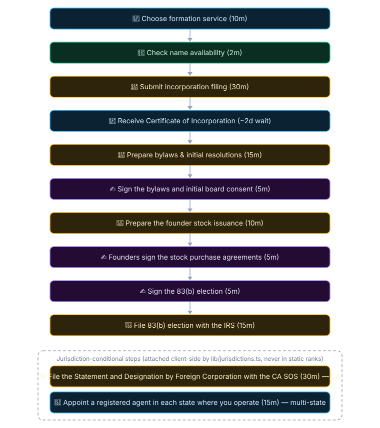

# Canonical process definitions

Author one `<slug>.json` definition in this directory. `lib/shared-processes/catalog.ts`
loads the complete catalog or a selected process with its reference closure. Each ordinary
record declares `entrySteps` and explicit `links`; absent links never imply a sequence.
`catalog.json` lists every definition in compatibility order; unlisted definitions fail validation.
Options retain their own nested parts and local links. Stable record, part and option IDs
bind external rankings, private additions and execution evidence.

Chains use the same record fields plus ordered `taskIds`. Their reference parts must match
that list exactly. Chains have empty `entrySteps` and `links`: the task list defines composition
order, while each referenced process supplies its own dependency graph.

Operational and chain views are projected in memory by `lib/processes.ts`. The equity
workflow files remain generated compatibility projections. Run `pnpm shared:project` after
editing definitions, then `pnpm shared:check`. Equity projections are not authoring inputs. Historical source receipts remain unchanged;
the export revision and catalog hash identify the current authored content.

Canonical records contain agent-agnostic process meaning. Private consumers preserve and
pin operational bindings separately; `toolCall` and `functionCalls` are rejected at every
canonical scope. Missing classifications and durations stay unknown. A complete duration
aggregate exists only when every contributing estimate is known. Manifest version 2 adds optional execution assessments and keeps missing estimates, unresolved
execution and unbound machine steps explicit. See [execution authoring](execution.md).

The normal `pnpm shared:export --output <catalog.json>` format-1 bundle includes ordinary
records' `entrySteps` and chains' ordered `taskIds`. It promotes selected authored verification,
recovery, context, geography and approval fields into notes for instruction assemblers.
Situations retain `kind: "situation"`; consumers must preserve their invocation policy.
Use `--example` for the fictional branch/rejoin fixture maintained under
`scripts/shared-processes/examples/`; it is separate from the authored catalog.

Export the format-2 candidate bundle with `pnpm exec tsx scripts/shared-processes/export-candidate.ts
--output <catalog.json> --lock <catalog.lock>`. Repeat `--process <slug>` to export a selection
and its referenced records. Commit source changes before exporting a pin.

## Record pages

Use the [startup task inventory](../coverage/STARTUP-TASKS.md) to find guides by lifecycle need and inspect conditional or specialist work.

Each canonical record in this directory renders as a Markdown page in [`pages/`](pages):
prerequisites and required inputs, a geography navigation table, a step overview with
dependencies, linked step instructions with routing and time estimates, decisions with
their options, and detailed country notes. Law-rule citations link to their rule cards,
and outputs link the work to the artifacts it produces. Chains show their constituent
processes with required and produced artifacts. The pages and the index below are generated
(`pnpm exec tsx scripts/generate-process-pages.ts`); edit the source record, then
regenerate. Drift gate: `__tests__/process-pages.test.ts`.

<!-- process-pages:index:start (generated — scripts/generate-process-pages.ts) -->

One page per canonical record: 199 processes, 33 situations, 24 chains.

### Processes

- [Acquire and integrate another business](pages/acquire-and-integrate-another-business.md)
- [Administer an employee equity plan](pages/administer-an-employee-equity-plan.md)
- [Answer a security questionnaire](pages/answer-a-security-questionnaire.md)
- [Apply for a research grant or innovation award](pages/apply-for-a-research-grant-or-innovation-award.md)
- [Apply to Y Combinator](pages/apply-to-y-combinator.md)
- [Appoint or replace directors and officers](pages/appoint-or-replace-directors-and-officers.md)
- [Approve a remote work location change](pages/approve-a-remote-work-location-change.md)
- [Approve a reserved corporate matter](pages/approve-a-reserved-corporate-matter.md)
- [Assess and file a patent application](pages/assess-and-file-a-patent-application.md)
- [Assess and manage AI product risk](pages/assess-and-manage-ai-product-risk.md)
- [Assess cross-border withholding before a payment](pages/assess-cross-border-withholding-before-a-payment.md)
- [Assess IPO readiness and public-company operations](pages/assess-ipo-readiness-and-public-company-operations.md)
- [Assess privacy impact before a processing change](pages/assess-privacy-impact-before-a-processing-change.md)
- [Assess product safety concerns and coordinate a recall](pages/assess-product-safety-concerns-and-coordinate-a-recall.md)
- [Assess regulatory approval before a product launch](pages/assess-regulatory-approval-before-a-product-launch.md)
- [Audit cap table](pages/audit-cap-table.md)
- [Bookkeeping close](pages/bookkeeping-close.md)
- [Build a hiring pipeline](pages/build-a-hiring-pipeline.md)
- [Build an SEO & content engine](pages/build-an-seo-content-engine.md)
- [Buy a domain](pages/buy-a-domain.md)
- [Change the company legal form](pages/convert-an-llc-to-a-c-corp.md)
- [Check domain availability](pages/check-domain-availability.md)
- [Claim research-and-development tax incentives](pages/claim-the-r-d-tax-credit.md)
- [Close a priced equity round](pages/close-a-priced-equity-round.md)
- [Close the fund](pages/close-the-fund.md)
- [Collect overdue invoices and resolve bad debt](pages/collect-overdue-invoices-and-resolve-bad-debt.md)
- [Complete a private secondary share sale](pages/complete-a-private-secondary-share-sale.md)
- [Complete SOC 2 Type II](pages/complete-soc-2-type-ii.md)
- [Connect a payment processor](pages/connect-a-payment-processor.md)
- [Connect a vendor or MCP server](pages/connect-a-vendor-or-mcp-server.md)
- [Consider a section 83(b) election after a restricted-property transfer](pages/consider-a-section-83-b-election-after-a-restricted-property-transfer.md)
- [Convert fundraising instruments at the priced round](pages/convert-safes-at-the-priced-round.md)
- [Coordinate a tax audit or examination](pages/coordinate-a-tax-audit-or-examination.md)
- [Create a project in your tracker](pages/create-a-project-in-your-tracker.md)
- [Create a subscription product](pages/create-a-subscription-product.md)
- [Create an issue from a task](pages/create-an-issue-from-a-task.md)
- [Cut a release](pages/cut-a-release.md)
- [Define the business model and unit economics](pages/define-the-business-model-and-unit-economics.md)
- [Draft and send an email](pages/draft-and-send-an-email.md)
- [Establish a channel or commercial partnership](pages/establish-a-channel-or-commercial-partnership.md)
- [Establish a foreign subsidiary or branch](pages/establish-a-foreign-subsidiary-or-branch.md)
- [Establish payment and purchasing approval controls](pages/establish-payment-and-purchasing-approval-controls.md)
- [Exercise employee stock options](pages/exercise-employee-stock-options.md)
- [File DE franchise tax](pages/file-de-franchise-tax.md)
- [File the company income tax return](pages/file-federal-tax-return.md)
- [File the recurring company registry return](pages/file-state-annual-report.md)
- [File trademark](pages/file-trademark.md)
- [Form a VC fund](pages/form-a-vc-fund.md)
- [Generate a brand logo](pages/generate-a-brand-logo.md)
- [Generate a company name](pages/generate-a-company-name.md)
- [Generate a website](pages/generate-a-website.md)
- [Get a 409A valuation](pages/get-a-409a-valuation.md)
- [Get insurance quotes](pages/get-insurance-quotes.md)
- [Get IP assignments signed](pages/get-ip-assignments-signed.md)
- [Handle an employee grievance](pages/handle-an-employee-grievance.md)
- [Hire abroad via an EOR](pages/hire-abroad-via-an-eor.md)
- [Hire an executive](pages/hire-an-executive.md)
- [Hire first employee](pages/hire-first-employee.md)
- [Hire intl contractor](pages/hire-intl-contractor.md)
- [Implement data retention and deletion controls](pages/implement-data-retention-and-deletion-controls.md)
- [Incorporate the company](pages/incorporate-c-corp.md)
- [Invite a teammate](pages/invite-a-teammate.md)
- [Issue 1099s](pages/issue-1099s.md)
- [Issue a refund](pages/issue-a-refund.md)
- [Issue employee equity awards](pages/issue-stock-options.md)
- [Keep board minutes on cadence](pages/keep-board-minutes-on-cadence.md)
- [Launch a referral program](pages/launch-a-referral-program.md)
- [Launch in the app stores](pages/launch-in-the-app-stores.md)
- [Launch on Product Hunt & directories](pages/launch-on-product-hunt-directories.md)
- [Lease an office](pages/lease-an-office.md)
- [Localize a product for a new market](pages/localize-a-product-for-a-new-market.md)
- [Maintain a personal data inventory](pages/maintain-a-personal-data-inventory.md)
- [Maintain the compliance obligations calendar](pages/maintain-the-compliance-obligations-calendar.md)
- [Make the repo agent-ready](pages/make-the-repo-agent-ready.md)
- [Manage a conflict of interest](pages/manage-a-conflict-of-interest.md)
- [Manage a customer renewal or expansion](pages/manage-a-customer-renewal-or-expansion.md)
- [Manage cash and treasury reserves](pages/manage-cash-and-treasury-reserves.md)
- [Manage cookies consent and marketing preferences](pages/manage-cookies-consent-and-marketing-preferences.md)
- [Manage employee leave and return to work](pages/manage-employee-leave-and-return-to-work.md)
- [Manage grant spending and reporting](pages/manage-grant-spending-and-reporting.md)
- [Manage inventory order fulfillment and returns](pages/manage-inventory-order-fulfillment-and-returns.md)
- [Manage the product roadmap](pages/manage-the-product-roadmap.md)
- [Manage vendor renewals and orderly offboarding](pages/manage-vendor-renewals-and-orderly-offboarding.md)
- [Manage vulnerability remediation and patching](pages/manage-vulnerability-remediation-and-patching.md)
- [Manage workplace safety and emergency readiness](pages/manage-workplace-safety-and-emergency-readiness.md)
- [Monitor debt covenants and lender reporting](pages/monitor-debt-covenants-and-lender-reporting.md)
- [Monitor trademark / handle availability](pages/monitor-trademark-handle-availability.md)
- [Negotiate SaaS agreement](pages/negotiate-saas-agreement.md)
- [Obtain business licenses and operating permits](pages/obtain-business-licenses-and-operating-permits.md)
- [Obtain the company tax identifiers](pages/get-ein.md)
- [Offboard a customer and deliver an authorized data export](pages/offboard-a-customer-and-deliver-an-authorized-data-export.md)
- [Offboard employee](pages/offboard-employee.md)
- [Onboard a contractor](pages/add-a-contractor-1099.md)
- [Onboard a new customer](pages/onboard-a-new-customer.md)
- [Onboard a new employee](pages/onboard-a-new-employee.md)
- [Open bank account](pages/open-bank-account.md)
- [Pay vendor invoices](pages/pay-vendor-invoices.md)
- [Pick a brand color palette](pages/pick-a-brand-color-palette.md)
- [Pick the right vendor for the task](pages/pick-the-right-vendor-for-the-task.md)
- [Plan and test product accessibility](pages/plan-and-test-product-accessibility.md)
- [Plan business continuity and alternate operations](pages/plan-business-continuity-and-alternate-operations.md)
- [Plan employee training and development](pages/plan-employee-training-and-development.md)
- [Plan founder and key-person succession](pages/plan-founder-and-key-person-succession.md)
- [Plan production quality and product release](pages/plan-production-quality-and-product-release.md)
- [Prepare a board meeting](pages/prepare-a-board-meeting.md)
- [Prepare and file sales tax VAT or GST returns](pages/prepare-and-file-sales-tax-vat-or-gst-returns.md)
- [Prepare for and complete an external financial audit](pages/prepare-for-and-complete-an-external-financial-audit.md)
- [Protect trade secrets and confidential know-how](pages/protect-trade-secrets-and-confidential-know-how.md)
- [Provision a workspace user](pages/provision-a-workspace-user.md)
- [Publish a status page & SLA](pages/publish-a-status-page-sla.md)
- [Publish privacy policy & DPA](pages/publish-privacy-policy-dpa.md)
- [Qualify a manufacturing or fulfillment supplier](pages/qualify-a-manufacturing-or-fulfillment-supplier.md)
- [Qualify a sales opportunity](pages/qualify-a-sales-opportunity.md)
- [Raise pre-seed funding](pages/raise-pre-seed-safes.md)
- [Register for sales tax, VAT or GST](pages/register-for-sales-tax-where-you-have-nexus.md)
- [Register state taxes](pages/register-state-taxes.md)
- [Renew insurance and coordinate a claim](pages/renew-insurance-and-coordinate-a-claim.md)
- [Reorganize into multiple teams](pages/reorganize-into-multiple-teams.md)
- [Review a cross-border personal data transfer](pages/review-a-cross-border-personal-data-transfer.md)
- [Review beneficial ownership reporting](pages/review-beneficial-ownership-reporting.md)
- [Review common-stock fair market value before a stock option grant](pages/review-common-stock-fair-market-value-before-a-stock-option-grant.md)
- [Review export controls sanctions and cross-border shipments](pages/review-export-controls-sanctions-and-cross-border-shipments.md)
- [Review open-source licenses and software dependencies](pages/review-open-source-licenses-and-software-dependencies.md)
- [Review state registration](pages/review-state-registration.md)
- [Review user access and privileged accounts](pages/review-user-access-and-privileged-accounts.md)
- [Roll out a pricing change](pages/roll-out-a-pricing-change.md)
- [Run a backup restoration and disaster recovery drill](pages/run-a-backup-restoration-and-disaster-recovery-drill.md)
- [Run a customer demonstration and evaluation](pages/run-a-customer-demonstration-or-pilot.md)
- [Run a paid customer acquisition experiment](pages/run-a-paid-customer-acquisition-experiment.md)
- [Run a performance improvement process](pages/run-a-performance-improvement-process.md)
- [Run a product beta or design-partner program](pages/run-a-product-beta-or-design-partner-program.md)
- [Run a win-back campaign](pages/run-a-win-back-campaign.md)
- [Run an incident postmortem](pages/run-an-incident-postmortem.md)
- [Run outbound sales sequences](pages/run-outbound-sales-sequences.md)
- [Run payroll](pages/run-payroll.md)
- [Run performance reviews](pages/run-performance-reviews.md)
- [Run security awareness training](pages/run-security-awareness-training.md)
- [Run the annual penetration test](pages/run-the-annual-penetration-test.md)
- [Run the fund back office](pages/run-the-fund-back-office.md)
- [Save a churning customer](pages/save-a-churning-customer.md)
- [Secure a business loan or credit facility](pages/secure-a-business-loan-or-credit-facility.md)
- [Sell the company through an acquisition](pages/sell-the-company-through-an-acquisition.md)
- [Send a wire or ACH payment](pages/send-a-wire-or-ach-payment.md)
- [Send an investor update](pages/send-an-investor-update.md)
- [Send an invoice](pages/send-an-invoice.md)
- [Send NDA](pages/send-nda.md)
- [Send the board financial report](pages/send-the-board-financial-report.md)
- [Set company OKRs](pages/set-company-okrs.md)
- [Set compensation bands and review pay](pages/set-compensation-bands-and-review-pay.md)
- [Set the annual budget & get board approval](pages/set-the-annual-budget-get-board-approval.md)
- [Set up a business phone number](pages/set-up-a-business-phone-number.md)
- [Set up a code hosting org](pages/set-up-a-code-hosting-org.md)
- [Set up a CRM](pages/set-up-a-crm.md)
- [Set up a data room](pages/set-up-a-data-room.md)
- [Set up a non-profit](pages/set-up-a-non-profit.md)
- [Set up a password manager](pages/set-up-a-password-manager.md)
- [Set up a project tracker](pages/set-up-a-project-tracker.md)
- [Set up a team wiki](pages/set-up-a-team-wiki.md)
- [Set up accounting](pages/set-up-accounting.md)
- [Set up AI code review](pages/set-up-ai-code-review.md)
- [Set up an LLC](pages/set-up-an-llc.md)
- [Set up ATS](pages/set-up-ats.md)
- [Set up benefits](pages/set-up-benefits.md)
- [Set up cap table](pages/set-up-cap-table.md)
- [Set up CI/CD](pages/set-up-ci-cd.md)
- [Set up cloud infrastructure](pages/set-up-cloud-infrastructure.md)
- [Set up company email & docs](pages/set-up-company-email-docs.md)
- [Set up credit card](pages/set-up-credit-card.md)
- [Set up custom domain](pages/set-up-custom-domain.md)
- [Set up customer support](pages/set-up-customer-support.md)
- [Set up device management (MDM)](pages/set-up-device-management-mdm.md)
- [Set up doc storage](pages/set-up-doc-storage.md)
- [Set up email marketing](pages/set-up-email-marketing.md)
- [Set up email routing on your domain](pages/set-up-email-routing-on-your-domain.md)
- [Set up error tracking](pages/set-up-error-tracking.md)
- [Set up expense management](pages/set-up-expense-management.md)
- [Set up mailing address](pages/set-up-mailing-address.md)
- [Set up on-call & incident response](pages/set-up-on-call-incident-response.md)
- [Set up payroll](pages/set-up-payroll.md)
- [Set up product analytics](pages/set-up-product-analytics.md)
- [Set up registered agent](pages/set-up-registered-agent.md)
- [Set up SSO & access management](pages/set-up-sso-access-management.md)
- [Set up subscription billing](pages/set-up-subscription-billing.md)
- [Set up team chat](pages/set-up-team-chat.md)
- [Set up transactional email](pages/set-up-transactional-email.md)
- [Set up transfer pricing and intercompany agreements](pages/set-up-transfer-pricing-and-intercompany-agreements.md)
- [Set up workplace retirement benefits](pages/set-up-a-401-k.md)
- [Ship a feature (spec to deploy)](pages/ship-a-feature-spec-to-deploy.md)
- [Shut down the company](pages/shut-down-the-company.md)
- [Sign the founder agreement & split equity](pages/sign-the-founder-agreement-split-equity.md)
- [Sponsor a work visa](pages/sponsor-a-work-visa.md)
- [Stand up a data warehouse & BI](pages/stand-up-a-data-warehouse-bi.md)
- [Start SOC 2 Type I](pages/start-soc-2-type-i.md)
- [Track company assets and equipment](pages/track-company-assets-and-equipment.md)
- [Track runway](pages/track-runway.md)
- [Update cap table](pages/update-cap-table.md)
- [Validate the idea](pages/validate-the-idea.md)
- [Vendor security review](pages/vendor-security-review.md)
- [Write the employee handbook](pages/write-the-employee-handbook.md)

### Situations

- [Absorb a pulled term sheet](pages/absorb-a-pulled-term-sheet.md)
- [Absorb the loss of your biggest customer](pages/absorb-the-loss-of-your-biggest-customer.md)
- [Answer a data-subject access request](pages/answer-a-data-subject-access-request.md)
- [Answer a tax-authority notice](pages/answer-an-irs-or-state-tax-notice.md)
- [Avert a missed payroll](pages/avert-a-missed-payroll.md)
- [Contain a chargeback or fraud spike](pages/contain-a-chargeback-or-fraud-spike.md)
- [Cure a Delaware franchise tax delinquency](pages/cure-a-delaware-franchise-tax-delinquency.md)
- [Cure a venture-debt covenant default](pages/cure-a-venture-debt-covenant-default.md)
- [Handle a co-founder departure](pages/handle-a-co-founder-departure.md)
- [Handle a key employee's resignation](pages/handle-a-key-employee-s-resignation.md)
- [Handle a press crisis](pages/handle-a-press-crisis.md)
- [Handle a security-vulnerability report](pages/handle-a-security-vulnerability-report.md)
- [Migrate off a shutting-down vendor](pages/migrate-off-a-shutting-down-vendor.md)
- [Recover a hijacked domain or social account](pages/recover-a-hijacked-domain-or-social-account.md)
- [Recover a suspended ad or platform account](pages/recover-a-suspended-ad-or-platform-account.md)
- [Recover from a frozen bank account or bank failure](pages/recover-from-a-frozen-bank-account-or-bank-failure.md)
- [Recover from a missed 83(b) deadline](pages/recover-from-a-missed-83-b-deadline.md)
- [Recover from a payment-processor account termination](pages/recover-from-a-payment-processor-account-termination.md)
- [Recover from an app-store rejection or removal](pages/recover-from-an-app-store-rejection-or-removal.md)
- [Report and manage a workplace injury](pages/report-and-manage-a-workplace-injury.md)
- [Respond to a cease-and-desist](pages/respond-to-a-cease-and-desist.md)
- [Respond to a data breach](pages/respond-to-a-data-breach.md)
- [Respond to a government subpoena or data request](pages/respond-to-a-government-subpoena-or-data-request.md)
- [Respond to a harassment complaint](pages/respond-to-a-harassment-complaint.md)
- [Respond to a lawsuit](pages/respond-to-a-lawsuit.md)
- [Respond to a patent demand letter](pages/respond-to-a-patent-demand-letter.md)
- [Respond to a trademark office action](pages/respond-to-a-trademark-office-action.md)
- [Respond to an acquisition approach](pages/respond-to-an-acquisition-approach.md)
- [Respond to an employee work-authorization refusal or evidence request](pages/handle-an-employee-s-visa-denial-or-rfe.md)
- [Run a reduction in force](pages/run-a-reduction-in-force.md)
- [Survive a DDoS attack or major outage](pages/survive-a-ddos-attack-or-major-outage.md)
- [Take a down round or recap](pages/take-a-down-round-or-recap.md)
- [Unstick a delayed US visa](pages/unstick-a-delayed-us-visa.md)

### Chains

- [Board & governance rhythm](pages/board-and-governance-rhythm.md)
- [Build the team](pages/build-the-team.md)
- [Company launch](pages/company-launch.md)
- [First hire](pages/first-hire.md)
- [Get paid](pages/get-paid.md)
- [Get the first 10 customers](pages/get-first-10-customers.md)
- [Go global](pages/go-global.md)
- [Land the enterprise deal](pages/land-the-enterprise-deal.md)
- [Launch a VC fund](pages/launch-a-vc-fund.md)
- [Launch on Product Hunt](pages/launch-on-product-hunt.md)
- [Launch the website](pages/launch-website.md)
- [Month-end close](pages/month-end-close.md)
- [Price and monetize](pages/price-and-monetize.md)
- [Raise a seed round](pages/raise-a-seed-round.md)
- [Raise the follow-on round](pages/go-fundraise-follow-on.md)
- [Run support & keep customers](pages/run-support-and-keep-customers.md)
- [Set up compliance (SOC 2-lite)](pages/set-up-compliance.md)
- [Set up the office stack](pages/set-up-the-office-stack.md)
- [Ship it right](pages/ship-it-right.md)
- [Ship v1](pages/ship-v1.md)
- [Tax season](pages/tax-season.md)
- [The agent-run back office](pages/agent-run-back-office.md)
- [The MCP-native stack](pages/mcp-native-stack.md)
- [Validate the idea & name the company](pages/name-the-company.md)

<!-- process-pages:index:end -->

The sections below document the legacy compatibility fields and external registries.

# Processes

Every founder process and reactive situation is a step-by-step record, each step assessed for execution,
timed, and wired to the judged vendor rankings; the fixtures and
the curation doctrine live here too. The artifact and company-field registries the steps
exchange live in [`open-artifacts/`](../open-artifacts/).

Canonical DAG definitions such as `generate-a-brand-logo.json` use
[`schemas/process.schema.json#/$defs/canonical`](../schemas/process.schema.json#/$defs/canonical),
generated from `lib/shared-processes/catalog.ts`.

The existing workflow and corpus layers retain their own contracts:

1. **Jurisdiction-scoped workflows** (`open-processes/<domain>/<jurisdiction>/*.json`, contract
   in `schemas/legacy-process.schema.json`, also accepted by `schemas/process.schema.json`): source-cited legal/tax workflows with explicit
   applicability dimensions, dated editorial review, law-rule references, stop conditions,
   and a scoped human approval on every externally-effectful step. Validated by
   `lib/founderOps.ts` inside the normal test gates; status `demonstration`, not
   production-certified (`policies/REVIEW_POLICY.md` has the maturity ladder).

2. **The process library** (canonical definitions in this directory, rendered live at
   [ultrametric.ai/processes](https://ultrametric.ai/processes), contract in
   `schemas/operational-process.schema.json`): step-by-step operating graphs with
   agent/form/human routing, judged vendor rankings per step, each process's agentic
   share, and time estimates. Operating guides, not legal advice; the site's jurisdiction
   toggle (`lib/jurisdictions.ts`) and geo scoping annotate where steps are US- or
   state-specific.

   The library carries two kinds of record: **processes** (the proactive founder timeline)
   and **situations** (`kind: "situation"`, reactive and trigger-driven: a cease-and-desist
   arrives, a visa is stuck, a breach is live). A situation is the same machinery plus a
   one-sentence `trigger` and an `urgency` clock (`hours`/`days`/`weeks`), and deliberately
   no `timeOrder` slot: reactive work is not a stop on the founder timeline. Where a
   situation leans on a legal deadline, its description cites a dated law rule in `open-law/`
   and its steps link the primary source. Doctrine: `SITUATIONS.md`.

The two layers keep separate IDs and never silently substitute for each other:
`lib/processes.ts` `loadProcesses()` projects operational definitions from `catalog.json`;
the workflow validator (`lib/founderOps.ts`) validates canonical definitions and the
separately generated jurisdiction workflows against their respective schemas.

| Section | What it covers |
| --- | --- |
| [What a library record is](#what-a-library-record-is) | The shape of one process record |
| [Reversibility](#reversibility) | Classifying how hard each step is to undo |
| [Verification checks](#verification-checks-verify) | The "how do I know it worked" check on a step |
| [Costs](#costs-cost) | Sourced, dated fees; nothing estimated |
| [Failure modes](#failure-modes-failuremodes--spike-introduced) | What concretely goes wrong, and the recovery |
| [Step documents](#step-documents-documents) | Steps linked to the open documents they are done on |
| [Proven runs](#proven-runs-provenruns--the-executed-proof-slot-design-only) | Evidence that a named operator ran a process |
| [The artifact layer](#the-artifact-layer-typed-inputsoutputs) | Typed inputs and outputs between processes |
| [The vendor registry](#the-vendor-registry-vendor-registryjson) | The vendor facts the process pages render |
| [The Open-modules map](#the-open-modules-map) | Wiring steps to the calculation modules |
| [The Incorporate C-Corp step graph](#the-incorporate-c-corp-step-graph) | One committed record as a diagram |
| [How the site consumes this directory](#how-the-site-consumes-this-directory) | Loaders and the pages they power |
| [What you can contribute here](#what-you-can-contribute-here) | The PR shapes and their gates |

## What a library record is

Each record covers one founder process: identity and classification (`phase`, `cadence`,
`complexity`), the Agentic % with its stated reason (`supportLevel` + `supportReason`), the vendors that can
run it, the step graph, and geo scoping. A trimmed real record (`form_002`, Get EIN):

```jsonc
{
  "id": "form_002",
  "title": "Get EIN",
  "phase": "formation",
  "cadence": "once",
  "complexity": "simple",
  "supportLevel": "manual_guide",
  "supportReason": "IRS EIN application is a web form with no API. System provides step-by-step guidance and pre-fills company data.",
  "vendors": ["irs", "stripe_atlas", "firstbase", "legalzoom"],
  "dag": {
    "nodes": [
      { "id": "n2", "label": "Pre-fill EIN application data", "route": "agent", "estimatedMinutes": 1 },
      { "id": "n3", "label": "Complete IRS SS-4 form online", "route": "form", "estimatedMinutes": 10 },
      { "id": "n4", "label": "Store EIN in company records", "route": "agent", "estimatedMinutes": 1 }
    ],
    "edges": [{ "from": "n2", "to": "n3" }, { "from": "n3", "to": "n4" }]
  },
  "geoScope": "us",
  "geoNotes": [{ "country": "IN", "kind": "absorbed", "summary": "PAN and TAN … are allotted automatically as part of the SPICe+ incorporation filing…", "actionUrl": "https://www.incometax.gov.in/iec/foportal/" } /* …UK/DE/FR analogs trimmed */]
  // …contextNeeded, tags, time totals, annoyance/risk/growthImpact trimmed
}
```

The historical routes in this abbreviated example are retained in canonical metadata.
Current execution assessments distinguish Agent Native, Agent Computer Use, Human Online
and Human Offline. The EIN preparation is local agent work; the IRS online application
retains its human owner, and storage needs a verified destination. Signature and approval
requirements remain independent properties. See [execution authoring](execution.md).

## Reversibility

Every process AND every step carries a required `reversibility` tier (founder ask 2026-09-30:
map what is irreversible, reversible, and "irreversible with pain"). The judgment test is
**"what does undoing actually take"** — never how risky or annoying the work is (that's `risk`
/ `annoyance`):

- **`reversible`** — freely undoable: drafts, configs, most SaaS setup, waits on third
  parties, internal governance paper a later consent supersedes. A routine external send whose
  correction costs nothing (a follow-up email) is reversible in practice.
- **`painful`** — irreversible with pain: undoable at real cost. Incorporating in the wrong
  state (re-domestication), entity conversion, switching payroll providers mid-year, migrating
  banks, breaking a lease, renaming the company, walking back a public announcement, unwinding
  an executed contract, withdrawing a government registration.
- **`irreversible`** — cannot be undone: dissolution filed, an 83(b) election filed (the
  missed window never reopens), equity issued and accepted, a wire sent, a refund processed,
  an employee terminated.

Curation rules: classify the **step's own act** — a "Receive the certificate" step commits
nothing (reversible) even though the filing before it did; a "Sign the X" step is reversible
while the paper is unfiled and unaccepted (the signed-but-unfiled 83(b)), and binding once
executed and accepted. The two levels are curated independently: a *painful* process can
contain one truly *irreversible* filing step (Incorporate C-Corp — the entity can be
dissolved, the filed 83(b) cannot be unfiled), and an *irreversible* process is mostly
reversible steps until the wire goes out. Irreversible is deliberately rare at both levels —
totality and distribution are pinned by `lib/__tests__/reversibility.test.ts`. No zod default
exists: an unclassified process or step fails the schema parse.

## Verification checks (`verify`)

Every step should answer **"how do I know it worked?"** — steps that have a concrete, externally
checkable test carry an optional `verify: { how, url? }` (depth wave pt 1, 2026-10-01):

- **What qualifies**: a check a founder can actually run against an external source of truth —
  the Delaware entity search showing the new entity, TSDR showing the trademark serial number,
  EDGAR full-text search showing the accepted Form D, an RDAP/WHOIS lookup showing the domain,
  the CP 575 notice for an EIN, pay stubs plus the provider's tax-deposit confirmation for a
  payroll run. Artifacts to *retain* (a date-stamped 83(b) copy, a certified-mail receipt, an
  executed Form 1583) qualify: the retained artifact IS the check.
- **What does not**: a restatement of the step ("account created" for a create-account step),
  internal drafting or decisions, anything with no external source of truth. A `verify` that
  restates the step is worse than absence — those steps simply carry no field.
- **URLs**: https only, primary sources preferred (government portals, registrar tools), and
  every URL is verified live before it ships — same bar as `actionUrl`. Steps whose check has
  no canonical tool carry `how` alone.

<!-- Legacy anchor: inbound links predate the heading rename. -->
<a id="cost-honesty-cost"></a>

## Costs (`cost`)

Steps with a real, KNOWABLE cost carry an optional
`cost: { usd, kind, source, asOf, note? }`. The rules:

- **Every number carries a source URL and an asOf date.** Fees change — the `asOf` date (when
  the number was read off the cited page) is the contract; currentness is never claimed.
- **Kinds**: `government-fee` (published fee schedules: Delaware filing fees and franchise-tax
  minimums, USPTO trademark fees, state filing fees), `free` (`usd: 0` where the authority says
  so — the IRS issues EINs for free, the SEC charges nothing for a Form D), and
  `typical-vendor-price` ONLY where a published sticker price exists (Stripe Atlas's $500,
  Apple's $99/yr — the pricing page is the source).
- **Never estimate.** A real cost with no published number ships as `usd: null` with the source
  explaining the variability ("attorney fees vary") — nothing is averaged or guessed. Anything
  that cannot be sourced does not ship at all.
- **`note`** carries the required caveat: minimums that scale (DE incorporation varies with
  authorized stock), per-class fees (USPTO), what a vendor price bundles.
- **Derived, never hand-stored**: the process-page "Known government fees: $X" headline is
  `knownCostUsd()` in `lib/processes.ts` — the sum of the dated per-step `government-fee`
  numbers ONLY. Vendor prices are excluded from the headline so it never implies a completeness
  the curation doesn't claim.

## Failure modes (`failureModes`) — spike-introduced

Introduced by the founder spike (2026-10-02) that took `form_001` to reference depth: steps
where something concretely goes wrong may carry
`failureModes: [{ what, then, source? }]` — what the failure is, and what the recovery
is. Curation rules, stricter than coverage:

- **Only sourced or structurally certain entries.** A Delaware name conflict (the §102(a)(1)
  distinguishability standard), a defective-certificate rejection (§103 — nothing exists until
  the 'Filed' endorsement), a lost stamped certificate (the published certified-copy fee), the
  missed 83(b) window (jurisdictional, no cure). Never speculation, never a generic "be
  careful".
- **`then` is the recovery as sourced** — including the recorded *absence* of one: the missed 83(b)
  window entry says there is no self-help fix, only a tax-counsel conversation (the
  needs-review posture). Legal claims cite a dated law rule in `open-law/` by id inside the
  prose, the same convention situation descriptions use.
- **`source`** is the primary page/statute/fee schedule backing the entry, curl-verified live
  like every committed URL.
- **3–6 quality entries per deep process**, not totality — absence means nothing is curated
  yet, never that the step can't fail. Display: one collapsed "⚠ if it goes wrong" line per
  affected step, rendered by the site's DAG component (private repo); no judged number reads
  the field.

## Step documents (`documents`)

Steps that are genuinely done ON a canonical open document may carry `documents: string[]` —
ids into `open-documents/registry.json` (the Cooley GO Delaware incorporation package for the
bylaws/stock-paperwork drafting steps, IRS Form 15620 for the 83(b) election). Added by the
form_001 spike after confirming no prior mechanism linked process steps to the documents
registry; extended across the library the same day (founder 2026-10-02: SAFEs on the SAFE-prep
step, the NVCA suite on the definitive-docs step, offer letters, SS-4, the open NDAs/DPAs/
cloud terms) — only where the document is plainly the
step's instrument, never forced totality. Rendered on the process pages as small external-link
chips by the site's DAG component (private repo), registry title as label, canonical URL as
target.
Referential integrity is gated both ways (`lib/__tests__/processDocuments.test.ts`) —
every id must resolve in the registry, and the render lookup throws on an unknown id.

## Proven runs (`provenRuns`) — the executed-proof slot (design only)

A process record can carry `provenRuns`: dated evidence that a named operator actually ran the
process end to end. The shape (`ProvenRunSchema` in `lib/processes.ts`):

- `ranOn` (ISO date), `operator` (a named person/company, never "a user"), `ownerRun`
  (boolean), `disclosure` (one plain sentence — **required whenever `ownerRun` is true**,
  load-enforced: reader trust comes from the disclosure, not from pretending independence);
- `steps: [{ nodeId, wallClockMinutes?, feesPaidUsd?, note? }]` — the REAL elapsed wall clock
  and the REAL fees paid per step, as run, never the committed estimates re-stated.

The field ships **empty and schema-ready**: no run is fabricated, and the committed estimates
stay estimates until a real record lands (the first will be Ultrametric Inc.'s own receipts,
supplied by the founder). When records exist they are display-only; no judged number reads
them.

## The artifact layer (typed inputs/outputs)

The artifact registry and the company-fields registry moved out of this directory to
[`open-artifacts/`](../open-artifacts/README.md): the registry is now
`open-artifacts/registry.json` and the typed field standards are `open-artifacts/fields.json`.
The process side of the contract (`produces`/`requires`, node-level `producesArtifact`) stays
in the corpus here.

The registry (founder depth wave part 2, 2026-10-01) is the vocabulary of canonical
business artifacts that flow BETWEEN processes — the EIN, the Certificate of Incorporation,
the bank account, the cap table, the 409A report, the payroll account. Each registry entry:
`id` (kebab-case), `label`, `description`, `producedBy` (the ONE canonical producer process),
optional `alsoProducedBy` (documented exceptions), optional `terminal: true`. On the library
side every process carries two required typed fields — `produces: string[]` and
`requires: string[]` (artifact ids) — and the specific step where an artifact comes into
existence is pinned with node-level `producesArtifact`. The `contextNeeded` prose stays the
human context; the typed layer is the machine truth, and `lib/processDeps.ts` builds the
company-level dependency graph from it (process page "Needs / Produces" chips, the derived
topological ordering, and the committed `docs/TIMELINE-INVERSIONS.md` renumbering worklist).

**What qualifies as an artifact.** A nameable business thing a committed process step genuinely
brings into existence AND that at least one other process genuinely consumes — or, rarely, a
real terminal output nothing downstream reads (the filed 83(b), the dissolution certificate),
flagged `terminal`. Not artifacts: judgments, meetings, recurring acts ("payroll was run"),
or anything no committed step produces. The registry is sized from the committed records — no
invented artifacts, no aspirational vocabulary.

**The one-producer rule.** Every artifact names exactly one canonical producer (`producedBy`)
so the dependency graph stays acyclic with unambiguous edges. Where a second committed process
genuinely also births the artifact — the LLC route applies for its own EIN, the LLC→C-Corp
conversion re-issues the charter paper, the exec hire signs an offer — that process is listed
in `alsoProducedBy` and may carry the artifact in its `produces`; graph edges still point at
the canonical producer, and an exception page's "Produces" chip links back to the canonical
process.

**How to add one.** Add the registry entry; add the artifact to the producer's `produces` and
tag the birth step with `producesArtifact` (never on a jurisdiction-conditional node — those
are stripped from the default view); add it to at least one other process's `requires` (or
flag it `terminal` with the reason in the description). Gates: the library tests
(`lib/__tests__/processArtifacts.test.ts` — totality, one-producer, consumed-or-terminal;
`lib/__tests__/processDeps.test.ts` — acyclicity, resolvable edges, no self-requires), and
regenerate the derived report: `npx tsx scripts/generate-timeline-inversions.ts` (drift-tested
— a stale `docs/TIMELINE-INVERSIONS.md` fails the suite). Published schema:
`schemas/process-artifacts.schema.json` (generated from `ArtifactRegistrySchema` in
`lib/processes.ts` by `scripts/generate-corpus-schemas.ts`).

**Reported, not auto-fixed.** The derived topological ordering is compared against the curated
`timeOrder` founder timeline; every inversion (a consumer curated before its producer) is a
row in `docs/TIMELINE-INVERSIONS.md` — the founder's renumbering worklist, never a silent
re-sort.

## The vendor registry (`vendor-registry.json`)

`vendor-registry.json` is the single source for the vendor facts the process pages render,
keyed by the snake_case vendor IDs referenced by canonical definitions and projected into
`vendor`/`vendorOptions`. Per vendor: the live arena that judges it (`arenaId`, absent
for a deliberately unlinked chip), a display `label` where title-casing the key misfires,
the judged `productId` where it differs from the key, the vendor's own verified-live
start-here page (`signupUrl`, curl-verified before listing; a vendor without one is simply
absent), and a curation `note`. `lib/processes.ts` reads it back (`loadVendorRegistry()`
and the `VENDOR_ARENA` / `VENDOR_SIGNUP_URL` / `vendorLabel` / `vendorProductId`
projections); the workflow validator (`lib/founderOps.ts`) deliberately skips the registry. Gate: `pnpm test lib/__tests__/vendorRegistry.test.ts` (the exports stay
pure projections of the registry). Published schema:
`schemas/process-vendor-registry.schema.json` (generated from `VendorRegistrySchema` in
`lib/processes.ts` by `scripts/generate-corpus-schemas.ts`).

## The Open-modules map

`business-logic-map.json` (founder 2026-10-02; the file name keeps the legacy
`business-logic` id from before the directory became `open-modules/`) wires the repo's open modules
(`lib/openstartup/`, indexed in `open-modules/README.md`) to the processes they serve — the
Delaware franchise-tax math to `tax_001` and the `sit_010` delinquency cure, the 83(b)/deadline
modules to the 83(b)-carrying processes, the cap-table/vesting/round/anti-dilution/waterfall
family to the founder agreement, option grants, and SAFE/priced rounds. Keyed by module id
(the `lib/openstartup/` file basename); each entry carries the README heading `label`, its
GitHub `anchor`, and the `processes` it serves — modules with no process target
are simply absent, nothing is forced.

**The step layer** (founder depth ask, same day): `steps` entries —
`{processId, nodeId, module, function, what}` — name the specific module FUNCTION that
genuinely computes a specific step's math (the 83(b) sign steps →
`election83b.compare83bScenario`, the filing steps → `deadlines.election83bWindow`, the
franchise-tax calculation → `deFranchiseTax.compareFranchiseTaxMethods`, …), curated from both
sides: the module's real exports and the step text. A step a module merely informs
stays task-level — no decorating. Every step entry's `(module, processId)` pair must also
appear in that module's `processes` list.

Read back by `lib/businessLogicMap.ts`; process pages render the task-level hits as a muted
"Open modules" chip line, and mapped step blocks get a tiny `compute: <module>.<function>`
chip, rendered by the site's DAG component (private repo), whose tooltip carries the `what` clause — both deep-linking
into `open-modules/README.md` (repo-first — the modules are a library by design, no site
pages). That README's per-module **Serves** lines are generated from this file
(`scripts/generate-business-logic-serves.ts`) and drift-gated. Totality gates, both ways:
`lib/__tests__/businessLogicMap.test.ts` (every module file exists, every process id exists,
every step's node id exists in its process graph, every named function is a real exported
function — a misspelled name fails the suite — and every anchor matches its README heading)
and `lib/__tests__/businessLogicServes.test.ts` (every mapped module's Serves line in sync,
no strays).

Run `pnpm exec tsx scripts/generate-process-arena-coverage.ts` to inspect current coverage.
The read-only audit prints vendor references resolved through `vendor-registry.json`,
unregistered vendors, invalid arena pointers, and processes resolving to zero arenas.
Coverage changes belong in canonical process definitions, `vendor-registry.json`, and
`open-rankings/categories.json`; `lib/__tests__/processArenaCoverage.test.ts` checks the
registry pointers and traversal of conditional and nested vendor references.

## The Incorporate C-Corp step graph

The diagram is `form_001` (Incorporate C-Corp) from canonical `incorporate-c-corp.json`:
`scripts/generate-process-diagram.mjs` draws the unfiltered operational projection's `dag.nodes` and
`dag.edges`, nothing invented, and is re-run when the definition changes. Glyphs: 🤖 `agent` ·
📝 `form` (manual web form) · 🧑 `person` · ✍ a `person` step with `legalSignature`
(legally required human signature). Presentation adoption of execution assessments is deferred.

<p align="center"></p>

## How the site consumes this directory

- `lib/processes.ts` `loadProcesses()` projects canonical definitions at build time — it strips the
  jurisdiction-conditional nodes (they only ever render client-side via the `?juris=` toggle,
  so no judged number moves) and powers `/processes`, every `/processes/<slug>` page
  (the site's DAG component, in the private repo, renders the step graph above with the same
  route colors), the process rankings (`/rankings/processes/*`), and the open startup
  simulator at `/startup-sim`.
- `loadChains()` projects canonical chains into ordered playbooks (see the Chains section below).
- `lib/founderOps.ts` validates the jurisdiction-scoped workflow layer (`equity/us-de/*`)
  against `schemas/process.schema.json`, resolves its law-rule references into `open-law/`
  (rules and `open-law/citations/`), and exposes the exact-dimension planner (`planFounderOps`).

## Process manifests

[`lib/processManifest.ts`](../lib/processManifest.ts) builds public manifests from the
process projections and committed arena data. The site serves one at
`/processes/{slug}/manifest.json` and composes playbooks at
`/processes/chains/{chain}/manifest.json`. Each embedded process retains its own manifest URL.
The builders are checked in
[`lib/__tests__/processManifest.test.ts`](../lib/__tests__/processManifest.test.ts).

`MANIFEST_VERSION` identifies the contract. Removing or renaming fields, changing their
types or meaning, or changing step-kind or approval semantics requires a version bump.
Additive optional fields keep the version. Consumers must reject unsupported versions
and ignore unknown optional fields. A manifest URL serves the current version; breaking
changes must update builders, routes, consumer checks, tests and this contract together.

Version 2 adds optional `execution` content assessments alongside the existing executor
`kind`. Existing kind, routing and approval semantics remain unchanged. Content consumers
use the assessment for category labels and review queues. Missing estimates remain absent
and missing routes retain `kind: "unclassified"`. Public canonical records contain no private operation bindings; private
consumers join their version-pinned bindings before deriving call-based approval behavior.

Executors must obtain explicit human approval for steps marked `approvalRequired`.
Explicit corpus gates and medium/high risk require approval for every route. Otherwise,
computer-use and unclassified steps require approval, and API steps require it unless
recorded calls exist and every call is read-only. Human steps keep the human as actor;
irreducible judgment, identity and legally required signatures remain human work.
Serving a manifest does not execute or authorize its steps. The provenance source
`productarena` is an immutable identifier.

## Chains

Chains are multi-process founder paths, each linking existing processes into a
founder-visible playbook (incorporate and launch, the VC raise, month-end close, the
agent-run back office).

The `loadChains()` view contains an id, a name, a one-line tagline, and an ordered list
of process IDs from the canonical catalog. Each referenced process owns its steps.
The projected `company-launch` record:

```json
{
  "id": "company-launch",
  "name": "Company launch",
  "tagline": "Incorporate, get the EIN, put the founders and cap table on paper, open the bank account, turn on payroll and the books.",
  "taskIds": ["form_001", "form_002", "qs_051", "startup_002", "qs_023", "qs_063", "qs_073"]
}
```

How the site consumes chains: `lib/processes.ts` `loadChains()` cross-checks every
`taskId`; chain pages render at `/processes/chains/<id>` with the member step graphs
stitched in order; the startup simulator (`/startup-sim`) drives a simulated company
through these chains; and the ⌘K palette surfaces each chain by the phrases people type
("raise a seed round") via `open-rankings/search-aliases.json`.

Contribute a new chain by linking existing process IDs into a founder-visible path (a
country-specific incorporation sequence, a wind-down, a first-enterprise-deal path), or
fix an existing one (reordering, a missing leg, a better description) with the reasoning
in the PR. Gate: `pnpm test` (`lib/__tests__/processes.test.ts` cross-checks every chain).

## What you can contribute here

- **A country analog for a process** — add a `geoNotes` entry to the process's canonical
  definition (`open-processes/<slug>.json`, under `metadata.geoNotes`): `{country, kind, summary, actionUrl, actionLabel}` with a live,
  official actionUrl (Companies House, MCA/NSWS, Handelsregister, INPI…). `kind` is curated
  from the summary's own truth: `analog` (the need exists there as its own doable process),
  `absorbed` (handled automatically inside another process there — PAN/TAN arrive with the
  SPICe+ incorporation), or `not-applicable` (the need genuinely doesn't exist there — the UK
  has no 1099 regime). This renders in the top-of-page geo banner and the "Outside the US"
  block, and `kind` drives which US-scoped rows the /processes table shows inside a country
  view (only `analog` rows stay; the default and Global views keep the full library). Gate:
  `pnpm test` (library loader + schema tests).
- **A new jurisdiction-scoped workflow** — copy `templates/process.json` into
  `open-processes/<domain>/<jurisdiction>/`, narrow the applicability dimensions, reference rule
  cards in `open-law/<CODE>/`, gate every external effect on a named human approval, add a
  fictional fixture in `open-processes/fixtures/`, and record the maturity grade in `open-law/workflow-coverage.json`.
  Gate: `pnpm test __tests__/founder-ops.test.ts`.
- **Corrections to an operational process** — step routing (agent / manual form / human),
  Agentic % values, or time estimates, edited in the canonical `<slug>.json` definition, with a source or reproduction for the claim.
  Gates: `pnpm test` and `pnpm shared:check`.
- **An artifact or a typed dependency** — a missing `requires` a committed step genuinely
  consumes, a missing registry artifact a committed step genuinely produces, or a terminal
  flag that should be a real consumer. Follow "The artifact layer" rules above (one canonical
  producer, no invented artifacts), regenerate `docs/TIMELINE-INVERSIONS.md`. Gate:
  `pnpm test` (`processArtifacts` + `processDeps` suites).

This area's maturity grade and known gaps are tracked in [`coverage/index.json`](../coverage/index.json).
