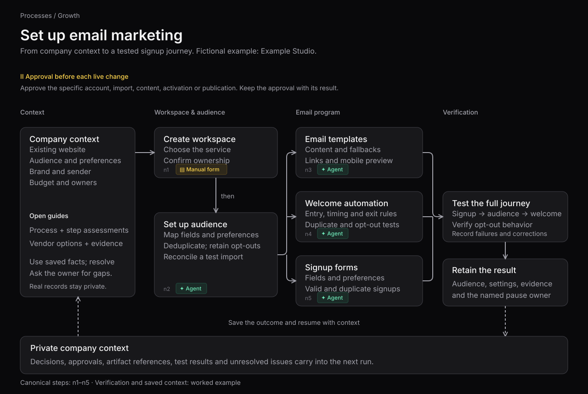

# Set up email marketing: worked example

Example Studio is a fictional company preparing a newsletter and a welcome sequence.
It already has a website. Its founder wants an email program with audience preferences,
reviewed content and a tested signup journey.

## Read the diagram

The workspace, audience and email-program boxes follow the authored routes in
[`set-up-email-marketing.json`](../set-up-email-marketing.json): `n1 → n2`, then
`n2 → n3`, `n2 → n4` and `n2 → n5`. Those branches can be prepared separately;
their dependencies still need checking before activation. The
[process page](../pages/set-up-email-marketing.md) gives each step's guidance,
execution assessment, vendor options and sources.

The context, full-journey check and saved-outcome boxes are the wrapper for this
worked example. They show how someone can use and verify the process, rather than
adding steps or dependencies to the canonical record. Follow each step's execution
assessment to decide which work uses an API, computer use or a person.

## Walk through the example

| Work | Example Studio's input or action | What to retain |
| --- | --- | --- |
| Establish context | Read the existing website, sender identity, brand assets, audience segments, budget and owners. Ask the founder about missing inputs. | Confirmed facts, sources, assumptions and unresolved questions. |
| Create the workspace (`n1`) | Compare the process's vendor options with the program's needs. Confirm company-controlled ownership and the agreed subscription before creating the workspace. | Vendor decision, account reference and approval. |
| Prepare the audience (`n2`) | Map source and preference fields, deduplicate, retain opt-outs and reconcile a small test import. Resolve uncertain audience eligibility before import. | Marketing email audience reference, exclusions and import check. |
| Prepare the email program (`n3`, `n4`, `n5`) | Draft templates with personalization fallbacks; define welcome entry and exit rules; configure the signup form's reviewed fields and preferences. Test with fictional contacts and controlled test accounts. | Draft references, configuration choices and test findings. |
| Verify the journey | Check signup through audience entry and welcome delivery, including duplicate signups and opt-outs. Have the named owner review the results before authorizing activation or publication. After publication, verify a controlled signup on the live page. | Test results, corrections, scoped approvals and the person able to pause messages. |
| Save the outcome | Store decisions, artifact references, approvals, action receipts and unresolved issues in the company's private context. Read that context when resuming. | A durable record distinguishing prepared, approved, executed and verified work. |

An owner authorizes each specific external change, including account creation, imports,
content writes, activation and publication. Preparation and testing do not authorize
those changes. This example describes work to perform; it reports no completed account,
import, publication or send. Real contact data and action receipts belong in the
company's private system, as required by the [agent policy](../../policies/AGENT_POLICY.md).

## Sources and editing

Process meaning, prerequisites and the audience artifact come from the
[canonical record](../set-up-email-marketing.json). Vendor comparisons are available in
[the email-marketing market](../../open-rankings/email-marketing). Audience eligibility
and regional requirements must be resolved for the actual company using the process's
sources and any required review.

The [diagram](../assets/email-marketing-example.svg) is an editable SVG with
native text and a description for assistive technology. Typography, zinc surfaces and borders, gray connectors, and the agent/manual-form
badges follow the live [email-marketing process page](https://ultrametric.ai/processes/set-up-email-marketing).
The SVG specifies the site's Inter font with Arial and Helvetica fallbacks for viewers
that do not have Inter installed. The dashed return path marks saved context. The connected stages and feedback loop
were inspired by [RP1's architecture presentation](https://github.com/Roboparty/RP1#architecture);
the diagram and wording here are original.

When the canonical routes change, update the diagram and route explanation together.
